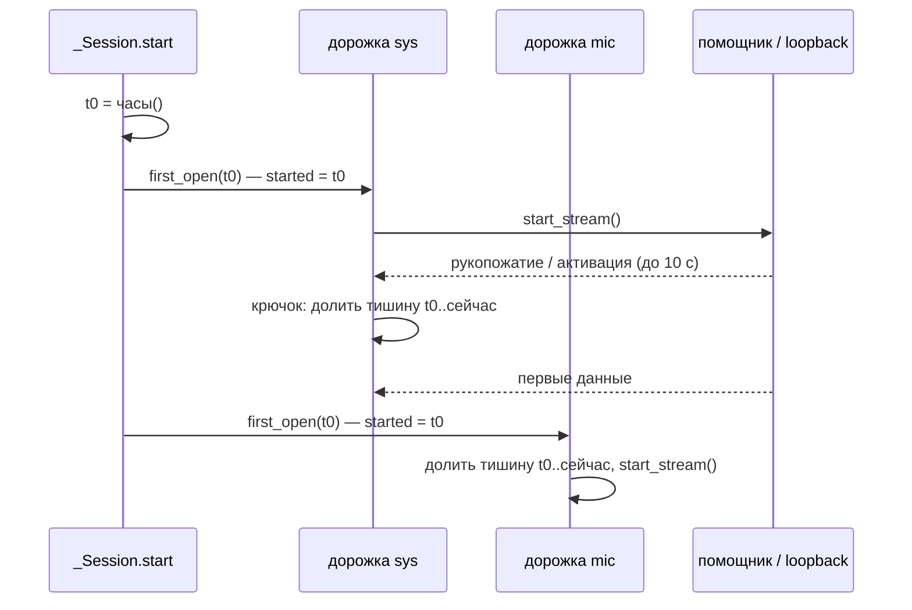
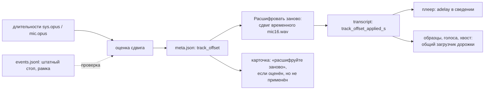

# Выпуск 0.6.2 — звук и текст совпадают - Plan

## Goal Capsule

- **Objective:** у пользователя Meet звук записи совпадает с её текстом — реплика «Вы» звучит в своё время, образец спикера играет ровно то, что написано, щелчок по слову ведёт к этому слову; на Mac запись и плеер работают без известных сбоев; Codex снова выполняет ходы с правами, а Antigravity подключается как ещё один агент; настройки короче, и ни одна опция не пропала.
- **Means:** общий ноль времени у дорожок и доливка тишины там, где её сейчас теряют (KTD1–KTD3); поправка старых записей по разнице длительностей дорожек с проверкой по журналу событий при перерасшифровке (KTD4, KTD5); образец — один сегмент 3–10 с (R9); исправления Codex и новый провайдер `agy` (KTD7–KTD9).
- **Источник:** разбор `review-0.6.2.md` (база `main` @ 5887d70) и решения владельца в этой сессии; исследование кода и внешних источников — в разделе Sources.
- **Иерархия правды:** R-ID решают поведение для пользователя; KTD решают механизм в пределах своих R; юнит не отменяет ни того, ни другого. Правила проекта из `CLAUDE.md` (тексты по-русски, тесты без сети и без claude/codex, миграции `config.json`, стражи CSS, «сначала тест») действуют поверх плана.
- **Профиль исполнения:** одна поставка в `main`, коммит на юнит, как в 0.6.1. Push, удаление веток и выпуск — только с разрешения владельца. Юниты фаз независимы между фазами, кроме указанных зависимостей.
- **Остановиться и спросить владельца, если:** проверка `agy` (U20) показывает, что уровни доступа NONE/READ/USER не выразить без записи в его настройки или что разрешающие правила пользователя перебивают разовые запреты Meet, а запуск без настроек пользователя невозможен; калибровка дублей (U7) не сходится на доступных записях; слияние разделов требует сменить ключ `config.json`.
- **Кто доводит:** исполнитель (`ce-work`) делает юниты и автоматические проверки; список ручной проверки (Mac, живые модели, `agy`) проходит владелец перед выпуском.

---

## Product Contract

### Summary

0.6.2 убирает расхождение звука и текста в записи: дорожки собеседников и микрофона получают общий ноль, тишина больше не теряется при медленном старте и после пауз, старые записи выравниваются при перерасшифровке по служебным данным записи. Образцы спикеров, плеер и пословная подсветка показывают ровно то, что звучит. Codex перестаёт падать на MCP-серверах по адресу, появляется провайдер Antigravity CLI, путь macOS закрывается от известных рисков, разделы настроек сводятся с 17 до 13.

### Problem Frame

Пользователи жалуются, что «кусок записи не соответствует расшифровке». Причин несколько, и они складываются. Дорожки `sys` и `mic` получают каждая свой ноль времени (`recorder._Track._start_writer`), а открываются по очереди, поэтому микрофон сдвинут на время открытия звука собеседников — на Windows на десятые доли секунды, на Mac до нескольких секунд из-за рукопожатия помощника. Тишина на время активации process loopback и рукопожатия не доливается. После тишины в loopback (автозапись до входа в звонок) остаётся недолитый дефицит до 1,5 с. Сдвиг ломает сведение плеера, порядок реплик, поиск эха и утечек голоса.

Вторая жалоба — образцы в «Спикерах»: текст до 300 символов склеенной реплики, а звучат первые 6 с; плеер к тому же останавливается с опозданием до четверти секунды и захватывает начало чужой фразы.

Попутно найдено: Codex у пользователя с MCP-сервером по адресу падает на каждом ходе с правами (ошибка в выпущенном коде), `/model` у Codex ничего не меняет, на Mac дети CLI не гасятся при отмене, Ogg/Opus в окне Mac играет только с macOS 15.4, а Gemini CLI для личных аккаунтов с июня 2026 заменён на Antigravity CLI.

### Requirements

**Синхронизация новых записей**

- R1. Дорожки одной записи отсчитывают время от одного момента начала сессии; секунда `t` в `sys.opus` и в `mic.opus` — одно и то же стенное время с точностью до кадра звука.
- R2. Время медленного старта потока (рукопожатие помощника на Mac, активация process loopback на Windows, то же при переоткрытии) доливается тишиной перед первыми данными, а не после них.
- R3. Когда системный звук появляется после тишины, недолитый остаток перед возобновившимися данными не больше 0,2 с.
- R4. Расхождение часов устройства не вставляет секунду тишины посреди идущего звука: доливка во время звука идёт кусками не больше 0,2 с.
- R5. Собственный захват записи с ассистентом из консоли (`meet assist`, `run_live`) выполняет R1–R4 так же.

**Старые записи**

- R6. У старой записи с журналом событий сдвиг дорожек оценивается по служебным данным записи (длительности дорожек, журнал событий) и применяется при «Расшифровать заново»; текст, сведение плеера и образцы после этого согласованы. Файлы дорожек не перезаписываются. Запись без журнала, с нештатным закрытием или с оценкой вне рамки остаётся как была.
- R7. Поиск эха, соседей и утечки голоса владельца (`mic_dedupe`, `mic_split`, живой режим) даёт на выровненных записях не худший результат, чем сейчас на невыровненных.

**Образцы, плеер, слова**

- R8. Воспроизведение фрагмента останавливается на его конце с точностью не хуже 50 мс.
- R9. Образец фразы спикера — один сегмент длиной 3–10 с без пометки «неуверенно»; играет ровно от его начала до конца, текст — текст этого сегмента. Если такого нет — окно 6 с из более длинного сегмента, и текст — только слова внутри окна; если у спикера все сегменты короче 3 с — самый длинный целиком. Сегмент длиннее 10 с без пословного времени образцом не становится: текст и звук в нём не совместить. Правило одно для «Спикеров», «Разделить спикера», «Переразделить», «Голосов».
- R10. У образца видны время начала, длительность и кнопка «Остановить»; у пометки «(нахлёст)» — подсказка и ▶; при наведении на время реплики — точное время.
- R11. Щелчок по слову в расшифровке играет запись с этого слова; во время воспроизведения звучащее слово подсвечено — и в расшифровке, и в образцах.
- R12. В плеере карточки есть выбор «Обе · Собеседники · Вы»; у старой записи, где сдвиг оценён, но текст построен без него, карточка предлагает расшифровать заново, а если в записи есть ручные правки текста или спикеров — сначала предупреждает, что они будут заменены.

**Агенты**

- R13. Ходы Codex с любым уровнем доступа проходят, когда у пользователя есть MCP-серверы по адресу (url), из плагинов или обычные.
- R14. `/model имя` у Codex меняет модель следующих ходов.
- R15. Если Codex на Windows фактически работает только на чтение (не настроена его песочница), строка ассистента говорит об этом.
- R16. Строки вызовов инструментов Codex появляются в чате по ходу хода, а не после него.
- R17. Отмена или таймаут хода любого CLI-агента на macOS гасит всё дерево его процессов.
- R18. На Mac Meet находит CLI, установленные через pnpm, mise и asdf.
- R19. Файлы входа Gemini и Antigravity (CLI и настольного приложения) входят в список секретов, которые Meet закрывает от агента там, где провайдер применяет запреты по путям (Claude Code, OpenCode, `agy`).
- R20. Antigravity CLI (`agy`) подключается провайдером с теми же уровнями доступа NONE/READ/USER, продолжением сеанса и выключенными MCP пользователя, что у Codex; отклонённое без согласия действие видно в чате; в настройках сказано об условиях потребительских тарифов и рекомендован ключ API.

**macOS**

- R21. Плеер карточки, образцы, «Голоса» и «Мой голос» играют на macOS 13, 14 и 15 с верным временем воспроизведения.
- R22. На macOS 14.4+ системный звук можно писать через Core Audio process tap без разрешения на запись экрана (API есть с 14.2, надёжно работает с 14.4); ScreenCaptureKit остаётся основным путём и единственным на более старых системах.

**Настройки и оформление**

- R23. Разделов настроек 13 вместо 17; ключи `config.json` прежние; любая прежняя ссылка на раздел открывает его новое место; ни одна опция не пропала.
- R24. Если строку, найденную поиском, скрывает выключенный переключатель, поиск говорит, что включить.
- R25. Опция, отличная от умолчания, помечена словом «изменено» (не только цветом); «Сбросить раздел» показывает список опций, которые вернутся, и кладёт умолчания этого пользователя в черновик — сохраняет пользователь. Сброс и метка «изменено» никогда не трогают согласия и историю (`analysis.consent`, `analysis.auto`, условия, мастер первого запуска), ключи с умолчанием по истории пользователя (`llm.provider`, `ui.theme`), закрытые от ассистента папки (`assist.kb_exclude`), режим «подтверждать каждое действие» (`assist.agent_mode: confirm`), пути и категории, и никогда не включает новый автоматический вызов модели без согласия.
- R26. «Подобрать под этот компьютер» в разделах «Распознавание» и «Модели и анализ» кладёт подходящие значения в черновик и перечисляет, что изменится и сколько придётся скачать; сохраняет пользователь. У разделов «Распознавание», «Спикеры», «Модели и анализ», «Ассистент» есть строка «как сейчас настроено» по сохранённым настройкам, каждая часть — ссылка на опцию.
- R27. Разделы настроек сверстаны по одному каркасу (отступы, ширина колонки, подсказка под опцией на токене приглушённого текста); на Mac запасной системный шрифт — системный шрифт macOS, а не Segoe; у окон без системной рамки (живая панель, панель трея) — отступ под кнопки окна; контраст `--accent-line` в светлой теме не ниже 4,5:1.

**MLX и видеоядра на Mac**

- R30. На Mac с macOS 14+ нерусская встреча расшифровывается MLX Whisper на видеоядрах Apple Silicon, с временем каждого слова той же формы, что сейчас; если MLX не установлен, не скачана модель или он упал — faster-whisper на процессоре, как сейчас. Новой настройки нет: выбор автоматический, модель видна в «Распознавании».
- R31. MLX ставится необязательным шагом установки движка только на macOS 14+; на macOS 13 установка движка проходит как сейчас, а в компонентах сказано «нужна macOS 14 или новее».
- R32. На Mac GigaAM, выравнивание слов и отпечатки голосов считаются на видеоядрах (MPS) с откатом на процессор при сбое; память видеоядер освобождается между задачами.

**Полировка macOS**

- R33. Если macOS не дала Meet доступ к микрофону, человек узнаёт это до или в первые секунды записи (плашка с кнопкой в нужный раздел «Конфиденциальности»), а не после встречи по расшифровке.
- R34. В мастере первого запуска на Mac есть шаг «Разрешения» (микрофон, запись экрана) с состоянием и кнопками «Разрешить» и «Открыть настройки»; пока разрешения не выданы, автозапись предупреждает уведомлением.
- R35. Cmd+Q, «Завершить Meet» в меню и выключение, перезагрузка или выход из системы завершают Meet штатно: идущая запись сохраняется целиком, выход системы не блокируется. Резидент на любой ОС штатно останавливает запись по сигналу завершения.
- R36. Пока идёт запись, компьютер (Mac и Windows) не засыпает от бездействия; если всё же спал (закрыта крышка), карточка говорит, с какого по какое время.
- R37. Микрофон на Mac следует за системным устройством и переоткрывается, если устройство пропало; микрофон Bluetooth-наушников не берётся, если программа звонка его не слушает, — об этом строка в «Звуке» и настройка «Не брать микрофон Bluetooth-наушников».
- R38. Панель ассистента и панель записи видны поверх полноэкранного звонка на любом рабочем столе и не перебрасывают на рабочий стол Meet; без открытого главного окна Meet живёт только в строке меню, без значка в Dock.
- R39. Токен Hugging Face на Mac хранит оболочка Meet; после обновления движка или Python системное окно «python хочет доступ к связке ключей» не появляется и задачи не зависают.
- R40. Тяжёлые задачи на Mac идут с пониженным приоритетом; число потоков распознавания и живого распознавания на Apple Silicon считается по производительным ядрам.
- R41. Меню приложения на Mac: «Meet» (О Meet, Настройки… Cmd+,, Скрыть, Завершить Meet Cmd+Q), «Файл» (Начать запись, Импортировать…, Закрыть окно Cmd+W), «Правка» (стандартные пункты — Cmd+C/V/Z/A работают в полях и терминале), «Окно», «Справка» (Открыть журналы).
- R42. Системный звук через ScreenCaptureKit берёт основной дисплей и переживает смену мониторов и закрытие крышки без перезапуска помощника.
- R43. Подсказки клавиш на Mac пишутся «⌘», выбор реплики и переход по репликам работают на Mac (⌘-щелчок, ⌥+←/→), в терминале «Агент» Cmd+C при выделении и Cmd+V.
- R44. Состояние записи видно в строке меню Mac с первого взгляда: длительность рядом со значком.
- R45. «Открывать при входе» на Mac — системный объект входа с настоящим состоянием; перенос Meet в другую папку его не ломает.
- R46. Запуск Meet на Mac не ждёт чтения PATH из оболочки и не вызывает запросы доступа к папкам; запросы к папкам и дискам, если появляются, объясняют, зачем.
- R47. Уведомления: в «Диагностике» видно, разрешены ли они, с кнопкой в настройки.
- R48. Сборка на Mac готова к переходу на Developer ID: файл прав (в том числе ввод звука) и пробная сборка с hardened runtime в CI.
- R49. `meet` из Терминала находит помощника записи и ffmpeg внутри Meet.app.
- R50. Движок и модели не попадают в Time Machine и Spotlight; пути с разным регистром и формой Unicode («й», «ё») на Mac считаются одним путём.

**Прочее**

- R28. Смена устройства с другой частотой работает без модуля `audioop`.
- R29. Распределение слов по спикерам на двухчасовой встрече не замедляется квадратично; результат прежний.

### Key Decisions

- **В 0.6.2 весь разбор, включая провайдер, настройки и дизайн.** (session-settled: user-directed — chosen over «только исправления, Gemini и настройки в 0.6.3»: владелец хочет закрыть разбор одним выпуском.) Governs R1–R29.
- **Старые записи правятся по служебным данным записи (длительности дорожек и журнал событий), а не по звуку, и только при перерасшифровке.** (session-settled: user-directed — chosen over оценки по совпадению звука и «только новые записи»: в гарнитуре общего звука нет, а с колонками задержка эха и сети неотделима от сдвига.) Governs R6, R12.
- **Образец — один сегмент 3–10 с целиком; окно 6 с со словами — только когда такого сегмента нет.** (session-settled: user-directed — chosen over окна 6 с из склеенной реплики: текст и звук совпадают по построению.) Governs R9.
- **Провайдер Google — Antigravity CLI `agy`.** (session-settled: user-directed — chosen over Gemini CLI с подсказкой про ключ API и над двумя провайдерами сразу: Gemini CLI для личных аккаунтов закрыт.) Governs R20.
- **В выпуск входят все четыре группы улучшений опыта: дорожки в плеере, образцы и нахлёсты, звучащее слово, умнее настройки.** (session-settled: user-directed — chosen over выбора части из них.) Governs R10–R12, R24–R26.
- **Process tap — дополнительный режим за выключателем, ScreenCaptureKit остаётся основным.** (session-settled: user-approved — chosen over замены основного пути: без реального Mac новый путь не проверить.) Governs R22.
- **Ключи настроек не меняются, сводится только окно.** (session-settled: user-approved — chosen over переименования ключей с миграцией: обновившийся пользователь ничего не теряет.) Governs R23.

- **MLX встраивается уже в 0.6.2: MLX Whisper для нерусских встреч на macOS 14+, GigaAM и голоса — на MPS.** (session-settled: user-directed — chosen over «в 0.6.2 только скрипт замера, встраивание по его итогам»: у владельца нет Mac для замера, а выигрыш MLX на видеоядрах ожидаем.) Governs R30, R31, R32.
- **В 0.6.2 вся полировка macOS из разбора, включая P2.** (session-settled: user-directed — chosen over «только P0 и P1» и «только P0».) Governs R33–R50.
- **Process tap остаётся необязательным режимом за выключателем и после разбора macOS.** (session-settled: user-directed — chosen over основного режима на 14.4+: без живого Mac новый путь не проверить.) Governs R22.

### Scope Boundaries

- Не меняется формат `config.json` и не добавляется миграция; новый ключ выключателя process tap (U22) не пишется в файл, пока равен умолчанию.
- Не входит вкладка «Агент» (встроенный терминал) для `agy`: Rust-оболочка не трогается.
- MLX не используется для русской речи (GigaAM лучше Whisper на русском, порты GigaAM на MLX сырые и без времени слов) и для разделения на спикеров (pyannote на MPS уже 20–25× реального времени; порт на CoreML — свой Swift-помощник, объём L).
- Рассмотрено и не строится: parakeet v3 на MLX — русский WER не проверен, лицензия CC-BY, метки по токенам; вернуться, если замер на записях покажет WER не хуже Whisper turbo. Apple SpeechAnalyzer — нет русского.
- Не входит распределение слов по эксклюзивной диаризации pyannote и пометка неуверенности по нахлёстам — это меняет результат диаризации и требует своей калибровки.
- Не делается ресемплинг против дрейфа часов (дорожка, чьё устройство спешит, по-прежнему уходит вперёд); R4 ограничивает только вставку тишины.
- Рассмотрено и не строится: проверка оценки сдвига по огибающим звука — разница длительностей дорожек точна по построению (KTD4), а огибающие без калиброванного порога добавили бы второй механизм ради редкого случая; вернуться, если на записях владельца оценка разойдётся со слуховой проверкой.
- Рассмотрено и не строится: поля к окну выравнивания `align.align_segments` — whisperX тоже берёт окно ровно по сегменту, свидетельств пользы нет; изменится, если на записи найдутся последние слова не на месте. Исправление пачек GigaAM — гипотеза разбора опровергнута: шаг кадра считается по каждому элементу. Проверка поддержки Ogg через `canPlayType` или пробную загрузку — ненадёжна в WebKit и ложно срабатывает на больших файлах; на macOS просто всегда WebM (KTD6).
- Не трогаются старые записи без журнала событий (до коммита 5fc031f, 2026-08-26).

#### Deferred to Follow-Up Work

- Gemini CLI для ключа API / Vertex и готовая запись «Gemini API» через OpenAI-совместимый адрес.
- `agy` во вкладке «Агент» и как модель с картинками (`VISION_PROVIDERS`), когда подтвердится приём изображений.
- Текст во время расшифровки (показ по мере готовности).
- «Проверить синхронизацию» вручную с подстройкой сдвига.

### Sources

- Разбор: `review-0.6.2.md` (вне репозитория, у владельца).
- Исследование этой сессии (машинно-локально, может пропасть; требования плана главнее): `C:\Users\thean\AppData\Local\Temp\claude\2405511063b88a46\623a8097-7231-4eb9-beaf-db4a0a75ebf8\scratchpad\ce-plan-research\` — `sync.md`, `speakers.md`, `providers.md`, `ux.md`, `web.md`.
- Gemini CLI заменён Antigravity CLI: https://geminicli.com/docs/get-started/authentication/ ; headless `agy`: https://antigravity.google/docs/cli/headless ; споры об условиях: https://discuss.ai.google.dev/t/is-external-orchestration-of-antigravity-cli-headless-mode-supported-with-account-based-usage/183051 .
- Codex 0.160: `codex exec --help` (`--approve-for-me` несовместим с `--sandbox`), проверки без модели — `providers.md` §0, §2.
- Образцы спецификаций и планов проекта: `docs/superpowers/specs/2026-10-13-0.6.1-card-and-mac-mic-design.md`, `docs/superpowers/plans/2026-10-13-0.6.1-card.md`.

---

## Planning Contract

### Key Technical Decisions

- KTD1. **Общий ноль передаётся параметром.** `_Session.start` берёт момент начала до первого `first_open` и передаёт его в `first_open` → `_start_writer`; все пути переоткрытия считают от `started` и меняться не должны. Для тестов — точка подмены часов на уровне модуля `recorder` (своих поддельных часов у recorder сейчас нет). Governs R1.
- KTD2. **Доливка после медленного старта — крючок «перед первыми данными» у потока.** `TapStream` (`mac_audio.py`, между проверкой рукопожатия и запуском читателя) и `ProcessLoopbackStream` (`process_loopback.py`, между `client.Start()` и первым чтением) вызывают обратный вызов дорожки, который доливает тишину до «сейчас». Крючок — атрибут потока, не аргумент `open`: `pyaudiowpatch` лишних аргументов не принимает. Обычный поток PortAudio стартует быстро и крючка не требует. Выбрано против второй доливки после `start_stream()`: та ставит тишину после первого буфера (гонка ~20 мс). Governs R2.
- KTD3. **Дефицит считается по времени захвата буфера, а не по времени прихода callback'а.** Запоздавший callback отдаёт накопленный звук пачкой — доливка по времени прихода сдвинула бы дорожку вперёд навсегда (поэтому у `live.WallClockWriter.PAD_GAP_S` порог 1 с). Дорожка берёт момент захвата первого кадра буфера: у потоков PortAudio — `time_info` callback'а (`input_buffer_adc_time` в часах потока, связанных с монотонными при старте) [проверить, что WASAPI loopback отдаёт его осмысленно; иначе — счётчик кадров с отметкой первого кадра после паузы]; у `TapStream` и `ProcessLoopbackStream` — счётчик кадров от старта. Перед записью буфера доливается дефицит больше 0,2 с относительно момента захвата — это возобновление после тишины (R3). `tick_pad` для потока без callback'ов оставляет порог 1 с, но доливает кусками по 0,2 с с отпусканием замка (R4). Governs R3, R4.
- KTD4. **Сдвиг старой записи — разница длительностей дорожек, журнал событий — проверка.** Обе дорожки при «Стоп» доливаются тишиной до одного момента (`_Session.close` → `_Track.close(until)`, коммит cbc09b6; раньше — до момента закрытия), поэтому `длительность(sys) − длительность(mic)` равна `mic.started − sys.started`. Новый модуль берёт длительности дорожек (ffprobe) и принимает оценку, если запись закрыта штатно (строка «запись остановлена штатно» в журнале) и оценка попадает в рамку из `events.jsonl`: от 0 до времени между «запись начата» и «mic.opus: …». Ранний `record.silence` у `sys` на Mac (вставка рукопожатия в первые секунды) причиной отказа не считается — он сдвигает только первые секунды. Результат — `meta.json` → `track_offset` (`mic_s`, `method: "durations"`, рамка, время оценки). Нет журнала, нештатное закрытие или оценка вне рамки — отказ с причиной. Governs R6.
- KTD5. **Сдвиг применяется в одном месте — к временному `mic16.wav`.** `transcribe._transcribe_two_track` после перевода дорожек в 16 кГц сдвигает временный файл микрофона (задержка или обрезка начала) — тогда распознавание, `interleave_tracks`, `mic_dedupe` и `mic_split` видят выровненный звук без правок каждой функции. Расшифровка пишет применённый сдвиг рядом с текстом (`transcript` → `track_offset_applied_s`); плеер, образцы и читатели сырого `mic.opus` (`segvoices`, `owner_derive`, `people`, обрезка хвоста) берут только применённый сдвиг через общий загрузчик дорожки. Оценённый, но не применённый сдвиг в плеере не участвует — иначе щелчок по реплике `mic` промахнётся. Governs R6, R12.
- KTD6. **На macOS окно всегда берёт звук в WebM/Opus.** Ogg/Opus в WebKit не играет до macOS 15.4, а на 15.4+ играет с неверным медиа-временем (WebKit 293310) — щелчок по слову и точная остановка промахивались бы. Резидент перепаковывает дорожку ffmpeg без перекодирования (`-c copy`) в кэш рядом с `playback.opus`, MIME `audio/webm` в `control.py`; на Windows (WebView2) остаётся Ogg. Определение платформы — один раз в окне, не по пробной загрузке: `canPlayType` в WebKit ненадёжен, а таймаут загрузки ложно срабатывает на больших файлах. Выбрано против перекода в AAC: копирование дешевле и без потерь. Governs R21.
- KTD7. **MCP у Codex выключается по виду транспорта.** `codex.mcp_servers()` сохраняет `transport.type` из `codex mcp list --json`; stdio → `{enabled=false,command=…}`, streamable_http → `{enabled=false,url="http://127.0.0.1:9/__meet_disabled_mcp__"}`, незнакомый вид → `--ignore-user-config`. Проверено на Codex 0.160 без модели. Governs R13.
- KTD8. **`--approve-for-me` остаётся без `--sandbox`.** Codex 0.160 сам ставит им workspace-write и перекрывает `sandbox_mode` пользователя; с `--sandbox` флаг отвергается при разборе. Ловушка Windows: без `[windows] sandbox` в `$CODEX_HOME/config.toml` ход фактически только читает — Meet читает этот единственный ключ (`tomllib`) и сообщает; сам ключ не ставит. При запасном `--ignore-user-config` передаётся значение пользователя `-c windows.sandbox=…` [проверить при исполнении]. Governs R15.
- KTD9. **`agy` — сначала проверка флагов на установленной версии, потом код.** Источники противоречат друг другу в деталях (разрешения, MCP, удаление сеанса). Правила доступа задаются только на один запуск (флаг или временный файл настроек через переменную окружения, если `agy` это умеет); в настройки пользователя `~/.gemini/antigravity-cli/` Meet не пишет и `--dangerously-skip-permissions` не использует. Разовые запреты Meet должны действовать и при разрешающих правилах пользователя или рабочей папки: если не действуют — `agy` запускается без настроек пользователя и проекта (аналог `--ignore-user-config` у Codex), если и это невозможно — провайдер не включается. Запреты USER — полный `opencode.bash_denials()` (удаление, отправка, `curl`/`wget`/`irm` с отправкой, `git push`, действия `gh`/`glab`, публикация пакетов, оболочки с кодом в строке), вынесенный в `consent` одной функцией для OpenCode и `agy`; в READ и USER — запреты на `consent.sensitive_paths()` и `.env`. Промпт — только через stdin; имя модели и id сеанса проверяются, запуск через `.cmd` с метасимволами cmd.exe в пути отклоняется (как `opencode.SHIM_UNSAFE`). Без диалога `agy` молча отклоняет несогласованное действие с кодом 0 — Meet разбирает пометку отказа из потока или stderr и показывает её строкой хода. Не в «Авто», не в `VISION_PROVIDERS`, не во вкладке «Агент». Governs R20.
- KTD10. **Умолчания раздела считает резидент, применяет окно через черновик.** Умолчания зависят от истории пользователя (`is_new`, `Analysis.upgraded()`), окно их не знает; наивное удаление ключей опасно — `Analysis.from_raw({})` даёт `auto=True`. Новый маршрут резидента отвечает на «ключи раздела» значениями по умолчанию для этого пользователя: копия его настроек без этих ключей, но с сохранёнными ключами истории и согласия, перечитанная через `settings.from_raw`, — и списком ключей, отличных от умолчания (метка «изменено»). В `config.json` маршрут не пишет. Окно показывает список возвращаемых опций, кладёт значения в черновик, «Сохранить» — обычный путь. Ключи, которые в `keys` раздела не входят никогда, — R25. В индекс настроек добавляется поле `keys`. Governs R25.
- KTD11. **Пословное время приходит в окно отдельным маршрутом.** `words.json` уже есть у записей; новый маршрут отдаёт слова сегментов, окно подгружает их лениво при открытии карточки. Подписка на время плеера — через ref, а не второй слушатель `onPlayhead` (он один, у `RecordingCard`). Governs R11.
- KTD12. **Остановка фрагмента по таймеру, а не по `timeupdate`.** `AudioPlayer` ставит точный таймер на `(until − currentTime) / playbackRate` при старте, переставляет его при смене скорости и перемотке и перепроверяет по `timeupdate`; `timeupdate` приходит ~4 раза в секунду и даёт опоздание до 0,25 с. Governs R8.
- KTD13. **`audioop` заменяется numpy с переносом состояния.** Линейная интерполяция с хвостом между вызовами, как у `audioop.ratecv`; моно/стерео — средним и повтором. `soxr` не добавляется: numpy и scipy уже в зависимостях. Governs R28.
- KTD14. **`_word_speaker` — бинарный поиск с префиксным максимумом концов.** Ходы с нахлёстом вложены, простой bisect по началу пропускает длинный ранний ход; правило ничьей «побеждает ранний ход» сохраняется. Governs R29.
- KTD15. **Process tap — отдельный режим помощника.** `audiotap` получает режим источника process tap (частное aggregate-устройство, исключение pid Meet), выбор — новый ключ настроек звука с умолчанием «ScreenCaptureKit». В `Info.plist` помощника — `NSAudioCaptureUsageDescription`. API проверки разрешения нет, а нули неотличимы от тишины (автозапись до звонка), поэтому во время записи нули не считаются отказом — только счётчик в журнале. Разрешение проверяется один раз, при включении выключателя: окно просит включить любой звук и нажать «Проверить», помощник пишет 5 с в режиме проверки; ненулевой звук — выключатель включается, нули — остаётся выключенным с подсказкой открыть «Конфиденциальность → Запись системного звука». Governs R22.

- KTD16. **MLX Whisper — новый бэкенд распознавания рядом с GigaAM и faster-whisper.** Модуль `mlx_asr` отдаёт сегменты и слова той же формы; перед вызовом — отсечение тишины тем же VAD, что у faster-whisper (`faster_whisper.vad`), подсказка терминов — через `initial_prompt` (у mlx-whisper нет `hotwords`). Импорт `mlx` только на macOS. Выбор в `asr.choose()`: Mac, macOS 14+, язык не русский, MLX и модель на месте → `mlx-whisper`; иначе как сейчас; сбой MLX → faster-whisper на процессоре со строкой причины в журнал. Модель — `mlx-community/whisper-large-v3-turbo` в `models.CATALOGUE` (только Mac). Governs R30.
- KTD17. **Установка MLX — необязательный шаг движка только на macOS 14+.** Как `uv_gigaam_step`: свой extra `mlx` с маркерами `sys_platform == 'darwin'`, отдельный файл точных версий для цели macOS 14, сбой шага не валит установку движка. MLX 0.30+ выпускается только для macOS 14+, а Meet поддерживает 13.0 — поэтому шаг, а не обязательная зависимость. Governs R31.
- KTD18. **MPS для GigaAM, wav2vec2 и голосов — с откатом, как у pyannote.** `torch_device()` на профиле mac разрешает `mps`; сбой операции на MPS → повтор на процессоре (образец — `diarize.pick_device` и откат в `diarize.py`); `torch.mps.empty_cache()` в `memory.release()` и после разделения на спикеров. Governs R32.
- KTD19. **Помощник `meet-audiotap` получает служебные режимы.** `--mic-status`, `--request-mic`, `--request-screen`, `--watch-devices` (строки JSON о смене устройства по умолчанию, списке устройств и «живости» выбранного) и тип подключения устройства. Запускает их цепочка Meet.app → резидент, поэтому macOS относит запросы к Meet. Признак отказа микрофона в записи — ровные нули во всех отсчётах дольше 3 с (у живого микрофона всегда есть шум) → событие `record.mic_silent`. Ссылки в «Системные настройки» — одна команда оболочки со списком разделов (микрофон, запись экрана, запись системного звука, уведомления), новый адрес настроек с откатом на старый. Governs R33, R34, R37, R42, R47.
- KTD20. **Выход: меню оболочки и сигнал резиденту.** Своё меню приложения на Mac; «Завершить Meet» и Cmd+Q ведут в `tray::quit` (с вопросом, если идёт запись); оболочка подписывается на уведомление о выключении системы и штатно гасит резидента с коротким сроком, затем выходит; резидент на SIGTERM (и на Windows — на событие закрытия консоли/сеанса, если применимо) останавливает запись тем же путём, что сторож оболочки. Выход системы не блокируется. Governs R35, R41.
- KTD21. **Запрет сна — на время записи, средствами ОС.** macOS — `IOPMAssertionCreateWithName(PreventUserIdleSystemSleep)` через ctypes (заодно снимает App Nap), Windows — `SetThreadExecutionState(ES_CONTINUOUS | ES_SYSTEM_REQUIRED)`; снимается при «Стоп». Пропуск длиннее минуты (закрытая крышка) — отметка в `meta.json` и строка в карточке. Governs R36.
- KTD22. **Панели на Mac — поверх полноэкранных окон, Meet — программа строки меню, пока нет главного окна.** `NSWindowCollectionBehavior` `canJoinAllSpaces | fullScreenAuxiliary` и плавающий уровень через `ns_window()`; `ActivationPolicy::Accessory`, пока нет обычных окон, `Regular` — пока открыто главное. Governs R38.
- KTD23. **Токен HF на Mac — в связке ключей от имени Meet.app.** Оболочка хранит токен (подписана постоянным сертификатом, доступ переживает обновления) и передаёт резиденту при запуске; `keyring` в Python на Mac — запасной путь с ограничением по времени. Секрет не печатается и не пишется в журналы. Governs R39.
- KTD24. **Автозапуск на Mac — `SMAppService.mainApp`.** Состояние читается из системы; `requiresApproval` — кнопка в «Объекты входа»; прежний LaunchAgent удаляется при переходе. Governs R45.

### High-Level Technical Design

Старт записи после исправления (KTD1, KTD2):

Старая запись: от оценки к плееру (KTD4, KTD5):

Уровни доступа `agy` (KTD9; флаги — после проверки в U20):

| Уровень | Рабочая область | Команды и правка | MCP |
|---|---|---|---|
| NONE | папка встречи | запрещены | выключены |
| READ | встреча, база знаний, библиотека | запрещены | выключены |
| USER | плюс рабочие папки | разрешены, кроме полного списка запретов OpenCode (KTD9) | выключены |

Во всех уровнях: запреты на `consent.sensitive_paths()` и `.env`; разовые правила Meet сильнее правил пользователя и рабочей папки (KTD9).

### Assumptions

- Журнал событий есть у записей с 2026-08-26 (коммит 5fc031f); для более старых поправки не будет.
- Материалы калибровки T0, на которые ссылается `mic_dedupe`, в репозитории отсутствуют (`.superpowers/sdd/v033/` нет); калибровку U7 делаем на доступных у владельца записях.
- Перерасшифровка заменяет `transcript.json` целиком: ручные правки текста и история спикеров не переносятся (поэтому предупреждение в R12).

### Sequencing

Фазы независимы, кроме зависимостей юнитов. Внутри «Синхронизации» сначала новые записи (U1–U4), потом старые (U5–U8): поправка опирается на те же точки времени. Codex U14 — первым среди агентов: это сломанная функция у пользователя сейчас.

---

## Implementation Units

| U | Что | Главные файлы | Зависит от |
|---|---|---|---|
| U1 | Общий ноль сессии | `src/meet/recorder.py` | — |
| U2 | Доливка после медленного старта | `mac_audio.py`, `process_loopback.py`, `recorder.py` | U1 |
| U3 | Доливка в callback'е и кусками | `recorder.py` | U1 |
| U4 | Свой захват ассистента | `src/meet/live.py` | U2, U3 |
| U5 | Оценка сдвига старой записи | новый `src/meet/track_sync.py`, `library.py`, `tray_control.py` | — |
| U6 | Применение сдвига при перерасшифровке | `transcribe.py`, `audio.py` | U5 |
| U7 | Пороги дублей на выровненных записях | `mic_dedupe.py`, `mic_split.py`, `live_dedupe.py` | U6 |
| U8 | Плеер и читатели сырой дорожки | `playback.py`, `segvoices.py`, `owner_derive.py`, `people.py`, `tail.py`, `merge.py` | U6 |
| U9 | Образец — сегмент 3–10 с | `speakers.py`, `speaker_split.py`, `rediarize.py`, `people.py` | — |
| U10 | Точная остановка и подробности образца | `AudioPlayer.tsx`, `SpeakersPanel.tsx`, `SplitView.tsx`, `RediarizeDialog.tsx`, `Turns.tsx`, `PersonCard.tsx`, `OwnerVoice.tsx` | U9 |
| U11 | Звучащее слово | `control.py`, `tray_control.py`, `lib/api.ts`, вид расшифровки | U10 |
| U12 | Дорожки в плеере и плашка сдвига | `tray_control.py`, `AudioPlayer.tsx`, `RecordingCard.tsx` | U5, U8 |
| U13 | `_word_speaker` быстрее | `src/meet/diarize.py` | — |
| U14 | Codex: MCP по виду транспорта | `src/meet/llm/codex.py` | — |
| U15 | Codex: модель и песочница Windows | `codex.py`, `participant.py` | U14 |
| U16 | Codex: строки инструментов по ходу | `codex.py`, `participant.py`, `llm/__init__.py` | U14 |
| U17 | Дерево процессов на POSIX | `llm/base.py`, `codex.py`, `opencode.py`, `detect.py` | — |
| U18 | Папки поиска CLI на Mac | `src/meet/llm/detect.py` | — |
| U19 | Секреты Gemini и Antigravity | `src/meet/llm/consent.py` | — |
| U20 | Провайдер `agy` | новый `src/meet/llm/antigravity.py`, `consent.py`, реестр, настройки, окно | U16, U17, U19, U23 |
| U21 | WebM-звук в окне на macOS | `AudioPlayer.tsx`, `PersonCard.tsx`, `OwnerVoice.tsx`, `control.py`, `playback.py` | U8 |
| U22 | Process tap на macOS 14.4+ | `mac/audiotap/main.swift`, `audiotap.py`, `mac_audio.py`, `settings.py` | U2 |
| U23 | Слияние разделов 17 → 13 | `SettingsPane.tsx`, `settingsIndex.ts`, секции, `live_asr.py`, `voice_id.py` | — |
| U24 | Поиск объясняет скрытую строку | `SettingsSearch`, `settingsIndex.ts` | U23 |
| U25 | «Изменено» и «Сбросить раздел» | `settings.py`, `tray_control.py`, секции окна | U23 |
| U26 | «Подобрать под этот компьютер» и строка состояния | секции окна, `tray_control.py` | U25 |
| U27 | Единая вёрстка и Mac | `theme/aurora-fixes.css`, CSS секций | U23 |
| U28 | Без `audioop` | `recorder.py`, `live.py` | — |
| U29 | Заметки выпуска и `CLAUDE.md` | `docs/release-notes/v0.6.2.md`, `CLAUDE.md` | U1–U28 |
| U30 | MLX Whisper — бэкенд распознавания | новый `src/meet/mlx_asr.py`, `asr.py`, `models.py`, `live_asr.py` | U9 |
| U31 | Необязательный шаг установки MLX | `engine.py`, `pyproject.toml`, `app/src-tauri/src/engine.rs`, фикстуры | U30 |
| U32 | GigaAM, выравнивание и голоса на MPS | `asr.py`, `gigaam_asr.py`, `align.py`, `voice_id.py`, `memory.py` | — |
| U33 | Отказ микрофона виден | `mac/audiotap/main.swift`, `audiotap.py`, `recorder.py`, `windows.rs`, `RecordingBadge.tsx` | U2 |
| U34 | Шаг «Разрешения» в мастере | `app/src/features/wizard/`, `tray_control.py`, `audiotap.py` | U33 |
| U35 | Штатный выход и меню на Mac | `app/src-tauri/src/main.rs`, `tray.rs`, `tray.py` | — |
| U36 | Запрет сна при записи | `recorder.py` (или новый `src/meet/keepawake.py`), `RecordingCard.tsx` | U1 |
| U37 | Микрофон следует за системным, Bluetooth | `main.swift`, `mac_audio.py`, `recorder.py`, раздел «Звук» | U33 |
| U38 | Панели поверх полноэкранного, без Dock | `live_panel.rs`, `tray_panel.rs`, `main.rs`, `Info.plist` | U35 |
| U39 | Токен HF в связке ключей оболочки | `credentials.py`, `app/src-tauri/src/` (хранилище), запуск резидента | — |
| U40 | Приоритет задач и потоки на Apple Silicon | `jobs.py`, `live_catchup.py`, `plat.py`, `asr.py`, `live_asr.py` | U32 |
| U41 | ScreenCaptureKit: основной дисплей | `mac/audiotap/main.swift` | U33 |
| U42 | Клавиши на Mac | `app/src/lib/platform.ts`, подсказки, `AudioPlayer.tsx`, `agentSessions.ts` | U10 |
| U43 | Длительность записи в строке меню | `app/src-tauri/src/tray.rs` | — |
| U44 | Автозапуск через объект входа | `app/src-tauri/src/autostart.rs`, `main.rs` | U35 |
| U45 | Быстрый запуск без ожидания PATH | `app/src-tauri/src/platform.rs` | — |
| U46 | Тексты запросов и состояние уведомлений | `macos/Info.plist`, `InfoPlist.strings`, «Диагностика», `windows.rs` | U33 |
| U47 | Подготовка к Developer ID | entitlements, `scripts/sign_macos.sh`, `release.yml` | — |
| U48 | `meet` из Терминала находит помощника | `audiotap.py`, поиск ffmpeg, `README.md` | — |
| U49 | Time Machine, Spotlight, ключ пути | `paths.py`/`engine.py`, `plat.py`, места ключей занятых папок | — |

### Фаза A. Синхронизация записи

### U1. Общий ноль сессии

- **Goal:** обе дорожки записи отсчитывают время от одного момента.
- **Requirements:** R1; KTD1.
- **Dependencies:** —
- **Files:** `src/meet/recorder.py`; тесты `tests/test_recorder.py`.
- **Approach:**
  1. Точка подмены часов в модуле; `_Session.start` берёт момент начала до цикла `first_open`.
  2. `first_open` и `_start_writer` принимают момент начала в обеих ветках (обычной и «помощник отказал»).
  3. Длительность в `_Session.close` по-прежнему от самого раннего `started` — теперь это общий ноль.
- **Patterns to follow:** фейки `_FakeAudioStream`, `_FakePyAudio`, `_session(...)` в `tests/test_recorder.py`.
- **Test scenarios:**
  - Выбор микрофона занимает 1,5 с (задержка в `pick`) → `started` обеих дорожек равны; в `mic` перед первыми данными ≈1,5 с тишины.
  - Переоткрытие `mic` посреди записи не меняет `started`, лента продолжается без скачка.
  - Дорожка `sys` на Mac с отказавшим помощником получает тот же ноль и доливается `tick_pad`.
  - Длительность записи считается от общего нуля.
- **Verification:** в новых записях `bytes_written` обеих дорожек в любой момент отличаются не больше чем на кадр плюс задержка callback'а.

### U2. Доливка после медленного старта потока

- **Goal:** время рукопожатия и активации не выпадает из ленты.
- **Requirements:** R2; KTD2.
- **Dependencies:** U1.
- **Files:** `src/meet/mac_audio.py`, `src/meet/process_loopback.py`, `src/meet/recorder.py`; тесты `tests/test_audiotap.py`, `tests/test_process_loopback.py`, `tests/test_recorder.py`.
- **Approach:**
  1. У `TapStream` и `ProcessLoopbackStream` — атрибут-крючок, вызываемый перед первыми данными.
  2. Дорожка ставит крючок в `_open` и `_open_process_loopback`; крючок доливает тишину до «сейчас» под замком дорожки.
  3. То же при переоткрытии помощника (`_tick_tap` → `reopen`).
- **Patterns to follow:** `FakeHelper`, `_popen_factory`, фикстура `mac_recorder` в `tests/test_audiotap.py`; `ProcessLoopbackStream(..., open_client=...)` в `tests/test_process_loopback.py`.
- **Test scenarios:**
  - Помощник отдаёт рукопожатие через 2 с → в `sys` перед первым PCM ≈2 с тишины, без тишины посреди звука после первого `tick_pad`.
  - Рукопожатие 0,4 с (меньше порога `tick_pad`) → тишина тоже доливается перед данными.
  - Активация process loopback 3 с → то же для Windows.
  - Переоткрытие помощника с рукопожатием 1 с → пауза долита перед новыми данными.
  - Помощник не прислал рукопожатие → прежнее поведение отказа (дорожка «missing»), крючок не вызывается.
- **Verification:** хлопок в начале встречи стоит в `sys.opus` и `mic.opus` в одно время (ручная проверка на Mac — в списке ниже).

### U3. Доливка по времени захвата и мелкими кусками

- **Goal:** после тишины в loopback и при дрейфе часов лента не расходится и не рвёт речь, а запоздавший callback её не сдвигает.
- **Requirements:** R3, R4; KTD3.
- **Dependencies:** U1.
- **Files:** `src/meet/recorder.py`, `src/meet/mac_audio.py`, `src/meet/process_loopback.py` (момент захвата буфера); тесты `tests/test_recorder.py`.
- **Approach:**
  1. Callback получает момент захвата первого кадра буфера (KTD3) и доливает дефицит больше 0,2 с относительно него.
  2. `_pad_silence` и `tick_pad` — куски по 0,2 с с отпусканием замка; событие `record.silence` — только для пауз дольше `TICK_PAD_S`.
- **Execution note:** сначала снять, что отдаёт `time_info` у WASAPI loopback в pyaudiowpatch на этой машине; если поле пустое или не монотонное — счётчик кадров (KTD3).
- **Test scenarios:**
  - Loopback молчит 7,3 с, потом пошёл звук → перед первыми данными дефицит ≤0,2 с.
  - Callback'и молчат 0,5 с, потом отдают накопленное пачкой с ранними моментами захвата → тишина не вставлена, длина дорожки равна стенному времени.
  - Дефицит растёт на 0,05 с за такт при идущем звуке → ни одной вставки длиннее 0,2 с.
  - Дефицит 0,15 с → не доливается, звук не рвётся.
  - Пауза 3 с без callback'ов → одно событие `record.silence`, не три.
- **Verification:** на записи с автозаписью до входа в звонок реплики собеседников совпадают со сведением (ручная проверка на Windows).

### U4. Свой захват записи с ассистентом

- **Goal:** `meet assist` из консоли пишет дорожки по тем же правилам.
- **Requirements:** R5.
- **Dependencies:** U2, U3.
- **Files:** `src/meet/live.py`; тесты `tests/test_live.py`.
- **Approach:**
  1. `WallClockWriter` получает начало координат параметром; в `_open_devices` это уже взятый `_t0`.
  2. Первое открытие потока — как переоткрытие: без старта → `catch_up` → старт.
  3. Для `TapStream` — тот же крючок из U2; порог доливки в `write` — как в KTD3.
- **Patterns to follow:** `_Clock` и тесты `WallClockWriter` в `tests/test_live.py`; `test_restart_pause_is_padded_before_the_stream_resumes`.
- **Test scenarios:**
  - Открытие `sys` занимает 1,2 с → у `mic` в начале 1,2 с тишины, `_started` обоих писателей равны.
  - Первое открытие доливает паузу до старта потока.
  - Перезапуск захвата после смены устройства не сдвигает ленту.
- **Verification:** под приложением ассистент читает отвод резидента (`_open_tap`) — после U1–U3 лента выровнена без правок отвода; тест отвода остаётся зелёным.

### U5. Оценка сдвига старой записи

- **Goal:** у старой записи есть точная оценка сдвига дорожек или явный отказ с причиной, и карточка о ней знает.
- **Requirements:** R6, R12; KTD4.
- **Dependencies:** —
- **Files:** новый `src/meet/track_sync.py`; `src/meet/library.py` (`update_meta`); `src/meet/tray_control.py` (оценка при открытии карточки); тесты — новый `tests/test_track_sync.py`, `tests/test_tray_control.py`.
- **Approach:**
  1. Длительности `sys.opus` и `mic.opus` (ffprobe), разница — оценка (KTD4).
  2. Проверка по `events.jsonl`: штатное закрытие, рамка от 0 до времени между «запись начата» и «mic.opus: …».
  3. Запись `track_offset` в `meta.json`; запись новой версии (общий ноль, U1) получает отметку «выровнено при записи» и не оценивается.
  4. Оценка выполняется один раз при открытии карточки двухдорожечной записи без `track_offset` (фоном, без декодирования звука) и при перерасшифровке, если её ещё нет.
- **Execution note:** до U6 прогнать оценщик на записях владельца и сообщить долю принятых оценок и их разброс; если оценки принимаются редко — остановиться и спросить владельца.
- **Patterns to follow:** `library.update_meta`; длительность через ffprobe — как в `playback.py` и `audio.py`.
- **Test scenarios:**
  - `sys` 3600,40 с, `mic` 3600,10 с, штатный стоп, рамка [0; 0,5] → оценка 0,30 с, метод `durations`.
  - Mac: разница 2,4 с, рамка [0; 2,9], ранний `record.silence` у `sys` → оценка принята.
  - Нет строки «запись остановлена штатно» → отказ «нештатное закрытие».
  - Оценка 1,2 с при рамке [0; 0,6] → отказ «вне рамки».
  - Отрицательная разница −0,05 с в пределах кадра → оценка 0.
  - Журнала нет → отказ, `meta.json` получает только причину.
  - Запись с отметкой «выровнено при записи» → оценка не выполняется.
  - Повторное открытие карточки → оценка не повторяется.
- **Verification:** на старых записях владельца оценка совпадает с хлопком / «раз-два» в начале (ручная проверка).

### U6. Применение сдвига при «Расшифровать заново»

- **Goal:** перерасшифрованная старая запись согласована по тексту и звуку.
- **Requirements:** R6; KTD5.
- **Dependencies:** U5.
- **Files:** `src/meet/transcribe.py` (`_transcribe_two_track`), `src/meet/audio.py` (`to_wav16k`); тесты `tests/test_transcribe.py`, `tests/test_track_sync.py`.
- **Approach:**
  1. Перед распознаванием — оценка (U5), если в `meta.json` её ещё нет.
  2. Сдвиг временного `mic16.wav` (задержка или обрезка начала); исходные дорожки не трогаются.
  3. Применённый сдвиг записывается вместе с текстом; распознавание без двух дорожек сдвиг не трогает.
- **Patterns to follow:** перевод в 16 кГц во временную папку в `_transcribe_two_track`.
- **Test scenarios:**
  - Оценка +0,4 с → временный `mic16.wav` начинается с 0,4 с тишины, текст хранит 0,4.
  - Оценка −0,3 с → начало временного файла обрезано на 0,3 с.
  - Отказ оценки → поведение как сейчас, применённый сдвиг 0.
  - Исходные `sys.opus` и `mic.opus` побайтно не изменились.
- **Verification:** реплики «Вы» встают в правильный порядок с репликами собеседников на тестовой записи со сдвигом.

### U7. Пороги дублей на выровненных записях

- **Goal:** поиск эха, соседей и утечки голоса работает не хуже после выравнивания — и в записи, и в живом режиме.
- **Requirements:** R7.
- **Dependencies:** U6.
- **Files:** `src/meet/mic_dedupe.py`, `src/meet/mic_split.py`, `src/meet/live_dedupe.py`; тесты `tests/test_mic_dedupe.py`, `tests/test_mic_split.py`, `tests/test_live_dedupe.py`.
- **Approach:** пороги (`NEIGHBOUR_MIN_LAG`, `PLAUSIBLE_LAG`, `LEAK_SEARCH`, `LEAK_MIN_LAG`) измерены на лагах, где сидит сдвиг старта; пересчитать их на записях владельца после выравнивания и закрепить тестами на синтетике с известными задержками эха (−0,05…−0,25 с) и соседа (+0,07…+0,29 с). Живой режим (`live_dedupe`) использует тот же `Lags` — закрепить тем же набором.
- **Execution note:** сначала прогнать текущие пороги на выровненных записях и сравнить число найденных эха и соседей с невыровненными; менять пороги только по этим данным.
- **Test scenarios:**
  - Эхо колонок с задержкой −0,15 с без сдвига старта → распознано как эхо.
  - Сосед по комнате +0,2 с → распознан как сосед.
  - Утечка голоса владельца +0,15 с в `sys` → проходит проверку утечки.
  - Живой режим: эхо −0,15 с и сосед +0,2 с → те же решения, что в записи.
- **Verification:** на записях владельца число найденных эха/соседей/утечек не меньше, чем до выравнивания; при расхождении — остановиться и спросить владельца (Goal Capsule).

### U8. Плеер и читатели сырой дорожки

- **Goal:** сведение, образцы и голоса учитывают применённый сдвиг.
- **Requirements:** R6; KTD5.
- **Dependencies:** U6.
- **Files:** `src/meet/playback.py` (`mix_command`, свежесть `playback.json`), `src/meet/segvoices.py`, `src/meet/owner_derive.py`, `src/meet/people.py`, `src/meet/tail.py`, `src/meet/merge.py`; тесты `tests/test_playback.py`, `tests/test_merge.py`, `tests/test_segvoices.py`.
- **Approach:**
  1. Общий загрузчик сырой дорожки с учётом применённого сдвига; читатели переходят на него.
  2. Сведение: задержка `mic` (или `sys` при отрицательном сдвиге); сдвиг входит в отметку свежести — старый `playback.opus` пересводится.
  3. Слияние частей: сдвиг на часть, применяется при склейке.
  4. Обрезка хвоста: точка обрезки `mic` смещается на сдвиг.
- **Patterns to follow:** `test_mix_command_normalizes_mic_and_mixes_both`, тесты свежести кэша в `tests/test_playback.py`.
- **Test scenarios:**
  - Применённый сдвиг 0,4 с → в команде сведения задержка 400 мс у `mic`.
  - Изменился сдвиг → кэш сведения не свежий.
  - Оценённый, но не применённый сдвиг → сведение без задержки.
  - Две части с разными сдвигами → склейка учитывает каждый.
  - Голос реплики `mic` берётся из сдвинутого места.
- **Verification:** щелчок по реплике «Вы» в перерасшифрованной записи играет её начало.

### Фаза B. Образцы, плеер, слова

### U9. Образец — сегмент 3–10 с

- **Goal:** у всех образцов спикеров текст совпадает со звуком.
- **Requirements:** R9.
- **Dependencies:** —
- **Files:** `src/meet/speakers.py`, `src/meet/speaker_split.py`, `src/meet/rediarize.py`, `src/meet/people.py`; тесты `tests/test_speakers.py`, `tests/test_speaker_split.py`, `tests/test_rediarize.py`, `tests/test_people.py`.
- **Approach:**
  1. Общая функция выбора образца по образцу `owner_derive._samples` (3–10 с, без «неуверенно»).
  2. Запасные пути — по R9: окно 6 с по словам более длинного сегмента; все сегменты короче 3 с — самый длинный целиком; сегмент длиннее 10 с без слов пропускается.
  3. Нет ни одного кандидата → образца нет, в панели — текст без ▶ и подсказка «нет подходящей фразы».
  4. Образец несёт слова со временем (для U11).
- **Test scenarios:**
  - Сегменты 2, 5, 14 с → образец — сегмент 5 с, текст его.
  - Только сегмент 14 с со словами → окно 6 с, текст — слова внутри окна.
  - Только сегмент 14 с без слов → образца нет.
  - Сегменты 14 с без слов и 2 с → взят сегмент 2 с целиком.
  - Сегмент 5 с с пометкой «неуверенно» и 4 с чистый → взят 4 с.
  - Все сегменты по 1,5 с → взят самый длинный целиком.
  - «Голоса»: самый длинный сегмент 40 с со словами → окно 6 с.
- **Verification:** в «Спикерах», «Разделить», «Переразделить» и «Голосах» звучит ровно показанный текст.

### U10. Точная остановка и подробности образца

- **Goal:** фрагмент не захватывает чужую фразу, пользователь видит, что играет.
- **Requirements:** R8, R10; KTD12.
- **Dependencies:** U9.
- **Files:** `app/src/features/card/AudioPlayer.tsx`, `app/src/features/card/speakers/SpeakersPanel.tsx`, `app/src/features/card/speakers/SplitView.tsx`, `app/src/features/card/RediarizeDialog.tsx`, `app/src/features/card/Turns.tsx`, «Голоса» и «Мой голос» (`PersonCard.tsx`, `OwnerVoice.tsx` — свои элементы `<audio>`); тесты `AudioPlayer.test.tsx`, `SpeakersPanel.test.tsx`, `RediarizeDialog.test.tsx`, тесты `PersonCard` и `OwnerVoice`.
- **Approach:**
  1. Точный таймер остановки (KTD12) — общий для плеера карточки и элементов «Голосов».
  2. Три копии `PHRASE_S` убрать; ▶ играет `start..end` образца, страховка 10 с.
  3. У образца — время начала, длительность, «Остановить»; запуск нового образца останавливает прежний.
  4. «(нахлёст)» — подсказка (`Tip`, доступна с клавиатуры) и ▶; точное время при наведении на время реплики.
- **Test scenarios:**
  - Фрагмент 3,0–8,0 с → `pause` на 8,0 с по поддельному таймеру, а не на следующем `timeupdate`.
  - Скорость 2× → таймер на 2,5 с; смена скорости посреди фрагмента переставляет таймер.
  - Перемотка во время фрагмента отменяет таймер.
  - Образец 4,2 с → подпись «0:12 · 4 с» и кнопка «Остановить» во время игры; второй ▶ останавливает первый образец.
  - «(нахлёст)» с ▶ играет нахлёст, подсказка открывается с клавиатуры.
  - Образец в «Голосах» останавливается на своём конце.
- **Verification:** стражи CSS и прокликивание зелёные; в образце не слышно начала следующей фразы.

### U11. Звучащее слово

- **Goal:** щелчок по слову играет с него, звучащее слово подсвечено.
- **Requirements:** R11; KTD11.
- **Dependencies:** U10.
- **Files:** `src/meet/control.py`, `src/meet/tray_control.py` (маршрут слов), `app/src/lib/api.ts`, вид расшифровки карточки (`app/src/features/card/`), `SpeakersPanel.tsx`; тесты `tests/test_tray_control.py`, тесты вида расшифровки в `app/src/features/card/`.
- **Approach:**
  1. Маршрут слов записи из `words.json`; сегменты без слов (ручная правка) — без пословной подсветки.
  2. Окно подгружает слова лениво; пока не загрузились или запрос упал — реплики ведут себя как сейчас.
  3. Элементы слов создаются только у играющей реплики и у реплики, по которой щёлкнули, а не у всей встречи.
  4. Щелчок играет со слова, только если нет выделения текста и реплика не в правке; клавиатура по-прежнему играет с начала реплики.
  5. Подсветка — по времени плеера через ref, без второго `onPlayhead`; токен `--accent-soft`, уживается с подсветкой поиска и отметкой `data-now`; в образцах — по словам образца (U9).
- **Test scenarios:**
  - Маршрут отдаёт слова сегментов с временем; у правленого сегмента слов нет.
  - Щелчок по слову на 12,34 с → `seek(12.34, play)`.
  - Выделение текста в реплике и отпускание мыши → воспроизведение не началось.
  - Реплика в правке → щелчок по слову не играет.
  - Время плеера 12,5 с → подсвечено слово, покрывающее 12,5; найденное поиском слово сохраняет подсветку поиска.
  - Сегмент без слов → подсвечена реплика, как сейчас.
- **Verification:** на длинной встрече (2 ч) прокрутка расшифровки не тормозит (ручная проверка), стражи CSS зелёные.

### U12. Дорожки в плеере и плашка сдвига

- **Goal:** можно послушать собеседников или себя отдельно; старая запись подсказывает перерасшифровку и не теряет правок без предупреждения.
- **Requirements:** R12.
- **Dependencies:** U5, U8.
- **Files:** `src/meet/tray_control.py` (маршрут дорожки по роли, признак ручных правок), `app/src/features/card/AudioPlayer.tsx`, `app/src/features/card/RecordingCard.tsx`; тесты `tests/test_tray_control.py`, `RecordingCard.test.tsx`, `AudioPlayer.test.tsx`.
- **Approach:**
  1. Переключатель — группа из трёх кнопок в подвале плеера (`radiogroup`, стрелки); смена дорожки сохраняет позицию и скорость, на время загрузки — состояние «загрузка».
  2. Дорожка «Вы» отдаётся с применённым сдвигом (U8); роль без дорожки — пункт отключён с подсказкой.
  3. Плашка над лентой: «Дорожки этой записи были сдвинуты на N с — расшифруйте заново, чтобы текст и звук совпали»; закрывается до следующего открытия карточки.
  4. Кнопка плашки при ручных правках текста или шагах истории спикеров сначала показывает подтверждение «Ручные исправления текста и спикеров будут заменены»; без правок — сразу.
- **Test scenarios:**
  - Переключение на «Вы» на 1:20 → играет `mic` с 1:20 с учётом сдвига, скорость прежняя.
  - Запись из одной дорожки → переключателя нет; нет `mic` → пункт «Вы» отключён.
  - Оценён 0,4 с, применён 0 → плашка; после перерасшифровки плашки нет.
  - Запись с правкой текста → нажатие на плашку показывает подтверждение, «Отмена» не запускает задачу.
  - Запись без правок → задача перерасшифровки запускается сразу.
- **Verification:** прокликивание без новых замечаний.

### U13. `_word_speaker` быстрее

- **Goal:** распределение слов не замедляется квадратично.
- **Requirements:** R29; KTD14.
- **Dependencies:** —
- **Files:** `src/meet/diarize.py`; тесты `tests/test_diarize.py`.
- **Execution note:** сначала тест на ничью при равном перекрытии (сейчас его нет) — он фиксирует прежний результат.
- **Test scenarios:**
  - Равное перекрытие двух ходов → слово у раннего.
  - Длинный ранний ход, внутри короткий → слово по наибольшему перекрытию, как раньше.
  - Случайные 5000 ходов и 20 000 слов → результат совпадает с прежним алгоритмом.
- **Verification:** на синтетике двух часов распределение быстрее прежнего в разы.

### Фаза C. Codex и агенты

### U14. Codex: MCP по виду транспорта

- **Goal:** ходы Codex проходят у пользователя с MCP-серверами по адресу.
- **Requirements:** R13; KTD7.
- **Dependencies:** —
- **Files:** `src/meet/llm/codex.py` (`mcp_servers`, `access_args`); тесты `tests/test_llm_codex.py`, заглушка `_mcp_list_json` в `tests/conftest.py`.
- **Execution note:** ошибка ломает ходы владельца сейчас — делать первым в фазе.
- **Test scenarios:**
  - Сервер stdio → `{enabled=false,command=…}`.
  - Сервер streamable_http → `{enabled=false,url=…}`, без `command`.
  - Сервер из плагина без транспорта в `config.toml` → по виду из `mcp list`.
  - Незнакомый вид транспорта → `--ignore-user-config`.
  - Список не прочитался → `--ignore-user-config`, как сейчас.
- **Verification:** ход Codex с правами проходит при `shipstudio-preview` в конфиге (ручная проверка у владельца).

### U15. Codex: модель и песочница Windows

- **Goal:** `/model` работает, а урезанные права видны.
- **Requirements:** R14, R15; KTD8.
- **Dependencies:** U14.
- **Files:** `src/meet/llm/codex.py` (`build_command`, `access_args`, докстринги), `src/meet/assist/participant.py`; тесты `tests/test_llm_codex.py`, `tests/test_assist_slash.py`.
- **Approach:** `-m` в команду (и после `resume`) с проверкой имени, как `settings.opencode_model_error`; чтение `windows.sandbox` из `$CODEX_HOME/config.toml`, без ключа — однократная строка ассистента; тест закрепляет `--approve-for-me` без `--sandbox`.
- **Test scenarios:**
  - `/model gpt-x` → в следующей команде `-m gpt-x`.
  - Имя с `&` или `%` → отказ с текстом, команда без `-m`.
  - USER на Windows без `[windows] sandbox` → строка «Codex сможет только читать…».
  - USER → в команде нет `--sandbox`.
- **Verification:** докстринги совпадают с поведением.

### U16. Codex: строки инструментов по ходу

- **Goal:** вызовы инструментов Codex видны в чате сразу.
- **Requirements:** R16.
- **Dependencies:** U14.
- **Files:** `src/meet/llm/codex.py` (`_exec`, `tool_events`), `src/meet/llm/__init__.py` (список потоковых провайдеров), `src/meet/assist/participant.py` (`_RunnerSession.send`); тесты `tests/test_llm_codex.py`, `tests/test_assist_participant*.py`.
- **Approach:** построчное чтение `--json` в потоке, `item.started` → вызов, `item.completed` → результат, передача в цикл через `call_soon_threadsafe`; потоковым провайдерам события после хода не проигрываются повторно.
- **Patterns to follow:** `claude_stream.Conversation` (`read_out`, `_emit`).
- **Test scenarios:**
  - Поддельный Codex отдаёт `item.started` и через паузу `item.completed` → строка появилась до возврата `run`.
  - Отмена посреди потока → дерево процессов убито, строки в состоянии «прервано».
  - OpenCode → поведение прежнее (события после хода).
  - Повторного создания строки по тому же id нет.
- **Verification:** живой ход Codex показывает строки по ходу (ручная проверка).

### U17. Дерево процессов на POSIX

- **Goal:** отмена хода гасит внуков на Mac.
- **Requirements:** R17.
- **Dependencies:** —
- **Files:** `src/meet/llm/base.py` (`kill_tree`, `run_tree`), `src/meet/llm/codex.py`, `src/meet/llm/opencode.py`, `src/meet/llm/detect.py`; тесты `tests/test_llm_base.py` (или ближайший), `tests/test_llm_codex.py`, `tests/test_llm_opencode.py`, тесты `claude_stream`.
- **Approach:** новая группа процессов при запуске на POSIX (`procjob.popen_kwargs()`); `kill_tree` — `killpg`, только если группа процесса — его собственная; служебные `subprocess.run` (`codex mcp list`, проверки входа) — через `run_tree`. Ctrl+C из консоли больше не доходит до ребёнка сам — `run` гасит дерево при отмене. Claude Code уже идёт через `procjob` (`claude_stream`) — закрепить это тестом, не переписывать.
- **Patterns to follow:** `procjob.kill_tree`.
- **Test scenarios:**
  - POSIX → в `Popen` Codex и OpenCode есть новая сессия.
  - `kill_tree` → `killpg` вызван с pid; `getpgid` вернул чужую группу → только `kill`.
  - Процесс уже завершился → без исключения.
  - Windows → прежний `taskkill /T`.
  - Отмена хода Claude Code на POSIX → `procjob.kill_tree` вызван.
- **Verification:** на Mac после отмены хода Codex нет живых `node` и MCP-серверов (ручная проверка).

### U18. Папки поиска CLI на Mac

- **Goal:** Meet находит CLI из pnpm, mise, asdf.
- **Requirements:** R18.
- **Dependencies:** —
- **Files:** `src/meet/llm/detect.py` (`_UNIX_DIRS`, `_unix_dirs`); тесты `tests/test_llm_detect.py`.
- **Approach:** `~/Library/pnpm`, `~/.local/share/pnpm`, `~/.local/share/mise/shims`, `~/.asdf/shims` и переменные `PNPM_HOME`, `MISE_DATA_DIR`, `ASDF_DATA_DIR`; папки shim'ов — последними, после nvm.
- **Test scenarios:**
  - `codex` только в `~/Library/pnpm` → найден.
  - `PNPM_HOME` задан → его папка в списке.
  - Один CLI в nvm и в shim'ах → взят из nvm.
- **Verification:** `test_unix_dirs_cover_common_installs` расширен.

### U19. Секреты Gemini и Antigravity

- **Goal:** агент не читает файлы входа Gemini и Antigravity.
- **Requirements:** R19.
- **Dependencies:** —
- **Files:** `src/meet/llm/consent.py` (`CLI_SECRETS`); тесты `tests/test_llm_consent*.py`.
- **Approach:** в `CLI_SECRETS` — `.gemini/oauth_creds.json`, `.gemini/google_accounts.json`, `.gemini/settings.json`, `.gemini/tmp`, `.gemini/antigravity` (настольное приложение), `.gemini/antigravity-cli`; если проверка в U20 найдёт вход `agy` в другом месте — дополнить там же.
- **Test scenarios:**
  - Чтение `~/.gemini/oauth_creds.json` в ходе READ → запрещено.
  - Чтение `~/.gemini/antigravity/` и `~/.gemini/antigravity-cli/` → запрещено.
  - Чтение `~/.gemini/GEMINI.md` → по общим правилам (не секрет).
- **Verification:** список секретов в докстринге и в коде совпадает.

### U20. Провайдер Antigravity CLI (`agy`)

- **Goal:** `agy` работает агентом встречи и моделью для итогов, как Codex.
- **Requirements:** R20; KTD9.
- **Dependencies:** U16, U17, U19, U23.
- **Files:** новый `src/meet/llm/antigravity.py`; `src/meet/llm/consent.py` (общая функция запретов для OpenCode и `agy`), `src/meet/llm/opencode.py` (переход на неё), `src/meet/llm/__init__.py` (реестр, ярлыки, `runner_for`, `forget_session`), `src/meet/llm/detect.py` (поиск `agy`, вход), `src/meet/check.py`, `src/meet/settings.py` (`LLM_PROVIDERS`, модель `agy`), `src/meet/assist/participant.py`, `src/meet/assist/slash.py`, `src/meet/assist/participant_prompts.py`, тексты «Подключите Claude Code, Codex или OpenCode» (`assist/app.py`, `assistant.py`, `cli_library.py`), `app/src/lib/llm.ts`, `app/src/features/settings/ModelsSection.tsx`, `settingsIndex.ts`; тесты — новые `tests/test_llm_antigravity.py`, `tests/test_llm_antigravity_detect.py`, правки `tests/conftest.py` (страж запуска и временный дом `agy`), `test_llm_opencode.py`, `test_llm_choice*.py`, `test_assist_slash.py`, тесты `ModelsSection`.
- **Execution note:** до кода владелец ставит `agy` на этой машине; исполнитель снимает `agy --help`, формат `stream-json`, поведение отказа без согласия, правила разрешений на один запуск и их приоритет над разрешающими правилами пользователя и рабочей папки, запуск без настроек пользователя, выключение MCP, удаление сеанса и где лежит вход — и записывает в начало модуля, что подтверждено. Условия остановки — Goal Capsule.
- **Approach:**
  1. Запуск: промпт через stdin, `--output-format stream-json`, продолжение `--conversation <id>`, модель `--model`; проверки имени модели, id сеанса и пути запуска — KTD9.
  2. Уровни доступа — по таблице в High-Level Technical Design и KTD9; запреты USER — общая функция в `consent` (OpenCode переходит на неё без изменения поведения).
  3. Разбор `step_update` с `step_type: tool` в `AgentReply.tools`; поток по ходу — механизмом U16.
  4. Разовые вызовы (итоги, названия) — своя папка и удаление сеанса после; `forget_session` для временной встречи.
  5. В «Моделях и анализе» — пункт Antigravity CLI, поле модели и предупреждение: на потребительских тарифах встраивание `agy` в сторонние приложения не поддерживается, рекомендован ключ API.
  6. Не в «Авто», не в `VISION_PROVIDERS` (картинки — пометкой, как у OpenCode).
- **Patterns to follow:** `src/meet/llm/opencode.py` (рабочая папка вызова, уборка сеансов, правила запретов, `SHIM_UNSAFE`, `_SESSION_ID`), `src/meet/llm/codex.py` (stdin, продолжение, `resume_failure`); тесты `tests/test_llm_opencode.py` (FakePopen, фикстура `fake`).
- **Test scenarios:**
  - NONE / READ / USER → ожидаемые флаги и правила; ни в одном нет `--dangerously-skip-permissions`.
  - USER → в правилах есть запреты `curl *-d*`, `git push*`, `powershell *` и удаления.
  - READ → запрещено чтение `consent.sensitive_paths()` (в том числе `daemon.json` и `~/.claude/.credentials.json`) и `.env`.
  - Командная строка или окружение отключают настройки пользователя, если проверка показала, что они перебивают запреты.
  - Имя модели с `&` или `%` → отказ; неверный id сеанса → новый сеанс с затравкой.
  - Разбор `stream-json`: `init` даёт id сеанса, `step_update` tool → вызов и результат, `result` → ответ.
  - Пометка отказа без согласия → строка хода «отклонено: нужно согласие».
  - Продолжился другой сеанс → `resume_failed`, затравка из журнала.
  - Вход не выполнен → понятный текст, без зависания.
  - Отмена → дерево процессов убито (U17); разовый вызов → сеанс удалён после.
  - Страж `conftest` ловит запуск `agy` в тестах.
  - OpenCode после переноса запретов в `consent` → те же правила, что раньше.
- **Verification:** «Проверить» в «Моделях и анализе» показывает `agy`; живой ход с каждым уровнем — в ручной проверке.

### Фаза D. macOS

### U21. WebM-звук в окне на macOS

- **Goal:** звук в окне играет на macOS 13–15 с верным временем.
- **Requirements:** R21; KTD6.
- **Dependencies:** U8.
- **Files:** `app/src/features/card/AudioPlayer.tsx`, общий помощник адреса звука в `app/src/lib/` (им пользуются плеер, образцы, `PersonCard.tsx`, `OwnerVoice.tsx`), `src/meet/control.py` (MIME), `src/meet/playback.py` (перепаковка в WebM, кэш), `src/meet/tray_control.py` (параметр формата у маршрутов дорожек и образцов); тесты `AudioPlayer.test.tsx`, тест помощника, `tests/test_playback.py`, `tests/test_tray_control.py`.
- **Approach:** окно на macOS добавляет к адресам звука формат WebM; резидент перепаковывает без перекодирования и кэширует рядом; пока перепаковка идёт — состояние плеера «Готовлю звук…»; если не вышло (нет ffmpeg, сбой) — «Не удалось подготовить звук» с причиной.
- **Test scenarios:**
  - Окно на macOS → все адреса звука с форматом WebM; на Windows — без него.
  - Запрос WebM → команда ffmpeg с копированием потока, MIME `audio/webm`, кэш свежий при неизменной дорожке и обновляется при изменённой.
  - Перепаковка дольше первой попытки загрузки → плеер показывает «Готовлю звук…», потом играет.
  - Сбой перепаковки → «Не удалось подготовить звук».
- **Verification:** плеер, образцы, «Голоса», «Мой голос» играют на macOS 13/14/15, щелчок по слову попадает (ручная проверка на Mac).

### U22. Process tap на macOS 14.4+

- **Goal:** системный звук без разрешения на запись экрана, по выбору.
- **Requirements:** R22; KTD15.
- **Dependencies:** U2.
- **Files:** `mac/audiotap/main.swift`, `Info.plist` помощника (там, где его собирает `scripts/build_release_macos.sh`), `src/meet/audiotap.py` (протокол: режим источника и режим проверки), `src/meet/mac_audio.py`, `src/meet/settings.py` (ключ выбора, не пишется при умолчании), окно — раздел «Звук»; тесты `tests/test_audiotap.py`, `tests/test_settings*.py`.
- **Approach:** режим process tap с исключением pid Meet через частное aggregate-устройство на встроенном выходе; то же рукопожатие и тот же формат PCM; включение выключателя — через проверку разрешения (KTD15); во время записи нули только считаются; на macOS < 14.4 выбор скрыт.
- **Execution note:** Swift здесь не собрать и не проверить — Python-часть и протокол покрыть тестами, Swift — сборкой в job `macos` и вручную на Mac (в том числе с AirPods как микрофоном: aggregate-устройство и переключение AirPods в режим гарнитуры).
- **Test scenarios:**
  - Ключ «process tap» → помощник запущен с режимом process tap.
  - Проверка при включении получила звук → выключатель включён.
  - Проверка получила только нули → выключатель остаётся выключенным, подсказка про «Запись системного звука».
  - Нули 5 с во время записи → без отката, счётчик в журнале.
  - Умолчание → ключ в `config.json` не записан.
  - macOS 14.3 → выбор недоступен.
- **Verification:** на Mac 14.4+ запись идёт без индикатора записи экрана (ручная проверка).

### Фаза E. Настройки и оформление

### U23. Слияние разделов 17 → 13

- **Goal:** разделов меньше, всё на месте, прежние ссылки ведут к нужному блоку.
- **Requirements:** R23.
- **Dependencies:** —
- **Files:** `app/src/features/settings/SettingsPane.tsx` (`sectionsOf`, `LEGACY_SECTION`), `app/src/features/settings/settingsIndex.ts` (`MENU_GROUPS`), секции «Распознавание», «Движок и модели», «Модели ИИ», «Анализ встречи», «Jira», «Экспорт», «Оформление», «Приложение»; места ссылок на раздел (`StorageNotices`, `MyVoice`, трей, живая панель, вкладка «Агент»); `src/meet/live_asr.py`, `src/meet/voice_id.py` (тексты «скачайте в «Движок и модели»» и `settingsFor`); тесты `SettingsPane.test.tsx`, `settingsIndex.test.tsx`, тесты Python этих текстов.
- **Approach:**
  1. Итоговые разделы (id — в скобках):

     | Группа | Разделы |
     |---|---|
     | Общее | Общее (`app`: «Оформление» + «Приложение») |
     | Запись | Звук (`sound`), Автозапись (`auto`) |
     | Расшифровка | Распознавание (`asr`, с блоком «Движок и модели»), Спикеры (`speakers`), Словарь (`dictionary`) |
     | ИИ | Модели и анализ (`models`, с блоком «Анализ встречи»), Ассистент (`assistant`) |
     | Встречи | Категории (`categories`), Экспорт и Jira (`export`) |
     | Система | Дополнительно (`advanced`), Диагностика (`diagnostics`), О программе (`about`) |

  2. `LEGACY_SECTION` получает раздел и якорь блока: `engine` → `asr#engine`, `analysis` и `markup` → `models#analysis`, `jira` → `export#jira`, `appearance` → `app#appearance`; при открытии по прежнему id окно прокручивает к блоку. Id `models` сохраняется (на него завязан `tray.rs` `MODELS_SECTION`).
  3. В «Общем» подписано: оформление применяется сразу, остальное — по «Сохранить».
  4. Поиск ждёт готовности данных раздела, а не фиксированные 2 с.
- **Test scenarios:**
  - 13 разделов в шести группах; каждый пункт индекса ведёт в существующий раздел.
  - Прежние `engine`, `jira`, `appearance`, `app`, `analysis`, `markup` открывают новое место и прокручивают к блоку.
  - Ссылка из «Моего голоса» на модели открывает блок моделей в «Распознавании».
  - Поиск по опции из блока движка находит её, когда данные движка пришли позже 2 с.
  - Текст Python про скачивание модели ведёт в новое место.
- **Verification:** ни одного ключа настроек не убрано (сверка списка ключей до и после), `cargo test` зелёный без правок Rust.

### U24. Поиск объясняет скрытую строку

- **Goal:** найденная, но скрытая опция не теряется.
- **Requirements:** R24.
- **Dependencies:** U23.
- **Files:** `app/src/features/settings/SettingsSearch*`, `settingsIndex.ts` (зависимость строки от переключателя); тесты `settingsIndex.test.tsx`, тест поиска.
- **Approach:** подсказка — строка под переключателем-условием «Включите «…», чтобы увидеть «…»»; держится, пока переключатель не изменён или не выбран другой результат; объявляется через `aria-live`; при цепочке условий называется первый выключенный.
- **Test scenarios:**
  - Найдена строка под выключенным переключателем → раздел открыт, переключатель подсвечен, подсказка под ним.
  - Пользователь включил переключатель → подсказка исчезла, искомая строка видна и подсвечена.
  - Цепочка из двух выключенных условий → названо первое.
  - Видимая строка → поведение прежнее.
- **Verification:** прокликивание без замечаний.

### U25. «Изменено» и «Сбросить раздел»

- **Goal:** видно, что настроено не по умолчанию, и это можно вернуть без потери согласий.
- **Requirements:** R25; KTD10.
- **Dependencies:** U23.
- **Files:** `src/meet/settings.py` (умолчания для пользователя по ключам), `src/meet/tray_control.py` и `src/meet/control.py` (маршрут «умолчания и отличия раздела»), `app/src/lib/api.ts`, `settingsIndex.ts` (поле `keys`), секции окна; тесты `tests/test_settings*.py`, `tests/test_tray_control.py`, `SettingsPane.test.tsx`.
- **Approach:**
  1. Маршрут резидента возвращает умолчания и список отличий по ключам раздела; в `config.json` не пишет (KTD10).
  2. «Изменено» — слово рядом с подписью опции, токен приглушённого текста, читается экранным диктором.
  3. «Сбросить раздел» — диалог со списком возвращаемых опций → значения в черновик → обычное «Сохранить».
  4. Ключи-исключения (R25) в `keys` не входят.
- **Test scenarios:**
  - Пользователь с consent «declined» сбрасывает «Модели и анализ» → после «Сохранить» `analysis.auto` false и consent прежний.
  - Пользователь с consent «granted» → то же, автоанализ включён, как был.
  - Новая установка (`version` есть, провайдер `auto`, тема `system`) → у провайдера и темы метки нет, сброс их не трогает.
  - Сброс раздела ассистента → `assist.kb_exclude` и `assist.agent_mode: confirm` на месте.
  - Ключ равен умолчанию → метки нет; диалог «Сбросить» без «Сохранить» → `config.json` не изменился.
  - Секреты (токены) не участвуют ни в сравнении, ни в ответе.
- **Verification:** `config.json` после сброса читается прежней версией (откат версии не ломается).

### U26. «Подобрать под этот компьютер» и строка состояния

- **Goal:** быстрая настройка без пресетов и понятное «как сейчас».
- **Requirements:** R26.
- **Dependencies:** U25.
- **Files:** секции «Распознавание», «Спикеры», «Модели и анализ», «Ассистент» окна; `src/meet/tray_control.py` (сведения о машине: видеокарта, процессор, Mac — уже собираемые для выбора движка); тесты секций.
- **Approach:**
  1. Набор значений: без NVIDIA — GigaAM на процессоре; NVIDIA с CUDA — GigaAM для русского и Whisper на видеокарте для остальных языков; Mac (Apple Silicon) — GigaAM на процессоре. Значения сверить с текущими умолчаниями `AsrChoice` при исполнении.
  2. Кнопка кладёт значения в черновик и показывает, что изменится и сколько скачать; отключена, пока сведения о машине загружаются; значения уже совпадают — «Уже подобрано».
  3. Строка «как сейчас настроено» — из сохранённых настроек (обобщение `nowLine` из `AsrChoice`), каждая часть — ссылка на опцию.
- **Test scenarios:**
  - Машина без NVIDIA → черновик: GigaAM на процессоре, список изменений и объём скачивания; без «Сохранить» `config.json` не изменился.
  - Mac → черновик под Apple Silicon.
  - Сведения о машине ещё загружаются → кнопка отключена.
  - Строка «GigaAM на процессоре, спикеры — pyannote, ассистент — Codex», щелчок по части прокручивает к опции; несохранённый черновик строку не меняет.
- **Verification:** прокликивание без замечаний.

### U27. Единая вёрстка настроек и Mac

- **Goal:** разделы выглядят одинаково, на Mac — родной вид.
- **Requirements:** R27.
- **Dependencies:** U23.
- **Files:** `app/src/theme/aurora-fixes.css`, `app/src/features/settings/settings.css` и CSS секций, места подсказок опций; стили живой панели и панели трея (окна без системной рамки).
- **Approach:** один каркас раздела на токенах Aurora — отступы и максимальная ширина колонки как у раздела «Звук», подсказка под опцией отдельной строкой на токене приглушённого текста; разделы, которые отличаются, приводятся к нему. Фирменные шрифты дизайн-системы не трогаются: в `aurora-fixes.css` на Mac системный шрифт macOS в запасной цепочке идёт раньше Segoe. Отступ под кнопки окна — только у окон без системной рамки.
- **Test expectation:** none -- вёрстка и стили; проверяют стражи CSS (`app/src/theme/*.test.ts`, `webkit.test.ts`) и прокликивание в двух темах.
- **Verification:** стражи зелёные; на Mac кнопки окна не перекрывают шапку живой панели и панели трея, контраст `--accent-line` в светлой теме не ниже 4,5:1 (ручная проверка).

### Фаза F. Прочее

### U28. Без `audioop`

- **Goal:** смена устройства с другой частотой не зависит от удалённого в Python 3.13 модуля.
- **Requirements:** R28; KTD13.
- **Dependencies:** —
- **Files:** `src/meet/recorder.py` (`_make_converter`), `src/meet/live.py` (`_track_converter`); тесты `tests/test_recorder.py` (уже есть путь без `audioop`, строки ~70–88).
- **Execution note:** сначала тест сравнения с `audioop` на 3.12 (пока он есть) — эталон для новой реализации.
- **Test scenarios:**
  - 48 кГц стерео → 16 кГц моно: длительность совпадает, расхождение с `audioop` в пределах шума.
  - Поток кусками по 1024 кадра → без щелчков на стыках (состояние переносится).
  - Совпадающий формат → данные без изменений.
  - Больше двух каналов → первые два.
- **Verification:** `import audioop` в коде нет.

### U29. Заметки выпуска и `CLAUDE.md`

- **Goal:** выпуск описан для пользователя и для следующего разработчика.
- **Requirements:** R1–R50 (описание поведения).
- **Dependencies:** U1–U28, U30–U49.
- **Files:** `docs/release-notes/v0.6.2.md` (по образцу `v0.6.1.md`), `CLAUDE.md` (разделы про запись, «Ассистент-участник», провайдеров, macOS).
- **Test expectation:** none -- документация.
- **Verification:** в заметках названы: выравнивание дорожек и «Расшифровать заново» для старых записей, ручные правки при перерасшифровке, Antigravity CLI и его условия, process tap как необязательный режим, что Codex запретов по путям не применяет (защита — песочница и просьба в промпте).

### Фаза G. MLX и видеоядра на Mac

### U30. MLX Whisper — бэкенд распознавания

- **Goal:** нерусская встреча на Mac 14+ расшифровывается на видеоядрах.
- **Requirements:** R30; KTD16.
- **Dependencies:** U9.
- **Files:** новый `src/meet/mlx_asr.py`; `src/meet/asr.py` (`choose()`, `Choice`), `src/meet/models.py` (`CATALOGUE`), `src/meet/live_asr.py`; тесты — новый `tests/test_mlx_asr.py`, `tests/test_asr*.py`, `tests/test_models*.py`, `tests/test_live_asr*.py`.
- **Approach:**
  1. `mlx_asr.transcribe(path, model, language, prompt, on_progress)` → сегменты и слова той же формы, что у faster-whisper; VAD перед вызовом; ход по концу сегмента.
  2. Выбор бэкенда и откат — KTD16; строка причины в журнал без текста встречи.
  3. Живое распознавание на Mac для нерусского — MLX Whisper короткими кусками без меток слов.
  4. Модель в каталоге только для Mac: показ, загрузка, удаление.
- **Execution note:** реального `mlx` здесь нет — тесты подставляют модуль `mlx_whisper` в `sys.modules`; живая проверка — в ручном списке.
- **Test scenarios:**
  - Подставной `mlx_whisper` вернул сегменты со словами → сегменты и слова Meet с теми же временами.
  - VAD вырезал тишину → время слов пересчитано к исходной записи.
  - Mac, macOS 14, английский, MLX и модель есть → `mlx-whisper`; русский → GigaAM; macOS 13 или Windows → как сейчас; модели нет → faster-whisper.
  - Подставной `mlx_whisper` бросил исключение → расшифровка через faster-whisper, причина в журнале.
  - Каталог: модель MLX видна только на Mac.
- **Verification:** без Mac — тесты; на Mac — ручной список.

### U31. Необязательный шаг установки MLX

- **Goal:** MLX ставится там, где может работать, и не ломает установку на macOS 13.
- **Requirements:** R31; KTD17.
- **Dependencies:** U30.
- **Files:** `pyproject.toml` (extra `mlx`), `src/meet/engine.py` (шаги установки, `OPTIONAL_PACKAGES`), файл точных версий для macOS 14 (рядом с `constraints-mac.txt`), `app/src-tauri/src/engine.rs` (шаг, пометка «нужна macOS 14 или новее»), фикстуры шагов Python и Rust; тесты `tests/test_engine*.py`, тесты `engine.rs`.
- **Patterns to follow:** `uv_gigaam_step` и его фикстуры.
- **Test scenarios:**
  - Профиль mac, macOS 14 → шаги включают MLX после основных; macOS 13 → шага нет, компоненты помечены.
  - Сбой шага MLX → движок установлен, файл ошибки шага записан, остальное работает.
  - Windows → шага нет.
  - Фикстуры Python и Rust совпадают.
- **Verification:** `cargo test` и pytest зелёные; сборка Mac в CI.

### U32. GigaAM, выравнивание и голоса на MPS

- **Goal:** на Mac основные модели считаются на видеоядрах.
- **Requirements:** R32; KTD18.
- **Dependencies:** —
- **Files:** `src/meet/asr.py` (`torch_device()`), `src/meet/gigaam_asr.py`, `src/meet/align.py`, `src/meet/voice_id.py`, `src/meet/memory.py`, `src/meet/diarize.py` (очистка кэша после разделения); тесты соответствующих модулей.
- **Test scenarios:**
  - Профиль mac, MPS доступен → GigaAM, выравнивание и голоса получают устройство `mps`.
  - Операция на MPS бросила `NotImplementedError` → повтор на процессоре, причина в журнале.
  - `memory.release()` на Mac вызывает очистку кэша MPS; на Windows — CUDA, как сейчас.
- **Verification:** скорость — ручной список на Mac.

### Фаза H. Полировка macOS

### U33. Отказ микрофона виден

- **Goal:** человек узнаёт о запрете микрофона сразу, а не после встречи.
- **Requirements:** R33; KTD19.
- **Dependencies:** U2.
- **Files:** `mac/audiotap/main.swift` (`--mic-status`, `--request-mic`, `--request-screen`), `src/meet/audiotap.py`, `src/meet/recorder.py` (признак ровных нулей, событие), `src/meet/events.py`, `app/src-tauri/src/windows.rs` (команда открытия раздела настроек со списком), `app/src/app/RecordingBadge.tsx` (плашка); тесты `tests/test_audiotap.py`, `tests/test_recorder.py`, тесты окна, тесты Rust.
- **Test scenarios:**
  - Дорожка микрофона отдаёт только нули 3,5 с → событие `record.mic_silent` один раз, плашка «Микрофон не слышно — проверьте разрешение».
  - Тихий, но живой микрофон (шум ±2 отсчёта) → события нет.
  - Команда открытия настроек принимает только разделы из списка; неизвестный → ошибка.
  - Протокол `--mic-status` разобран: разрешено, запрещено, не спрашивали, ограничено.
- **Verification:** на Mac — запрет микрофона и запись (ручной список).

### U34. Шаг «Разрешения» в мастере

- **Goal:** разрешения выдаются до первой встречи.
- **Requirements:** R34; KTD19.
- **Dependencies:** U33.
- **Files:** `app/src/features/wizard/` (новый шаг только для Mac), маршрут резидента состояния и запроса разрешений в `src/meet/tray_control.py`/`control.py`, «Настройки → Диагностика», уведомление автозаписи; тесты мастера, `tests/test_tray_control.py`.
- **Test scenarios:**
  - Mac → шаг показан после «Устройств»; Windows → шага нет.
  - Состояние перечитывается, когда окно получает фокус.
  - Автозапись при невыданном разрешении → уведомление, запись идёт.
- **Verification:** прокликивание; на Mac — чистая учётная запись (ручной список).

### U35. Штатный выход и меню на Mac

- **Goal:** Cmd+Q и выключение системы не теряют запись и не блокируют выход.
- **Requirements:** R35, R41; KTD20.
- **Dependencies:** —
- **Files:** `app/src-tauri/src/main.rs` (меню, `ExitRequested`, уведомление о выключении), `app/src-tauri/src/tray.rs` (`quit`), `src/meet/tray.py` (обработчик SIGTERM); тесты Rust (структура меню, обработка выхода), `tests/test_tray*.py`.
- **Test scenarios:**
  - SIGTERM резиденту во время записи → «Стоп» тем же путём, что у сторожа оболочки, хвост и `meta.json` дописаны.
  - Меню Mac содержит «Настройки…» с Cmd+, и «Завершить Meet» с Cmd+Q, «Правка» со стандартными пунктами.
  - «Завершить Meet» при идущей записи → вопрос; без записи → выход.
- **Verification:** `cargo test`, `cargo clippy`; на Mac — Cmd+Q и «Выключить…» (ручной список).

### U36. Запрет сна при записи

- **Goal:** запись не превращается в тишину из-за сна.
- **Requirements:** R36; KTD21.
- **Dependencies:** U1.
- **Files:** новый `src/meet/keepawake.py`, `src/meet/recorder.py` (включение и снятие), `app/src/features/card/RecordingCard.tsx` (строка о сне); тесты — новый `tests/test_keepawake.py`, `tests/test_recorder.py`.
- **Test scenarios:**
  - Старт записи → запрет сна взят; «Стоп» и сбой записи → снят.
  - Windows → вызов `SetThreadExecutionState` с нужными флагами; Mac → утверждение питания создано и освобождено (через подставной вызов).
  - Пропуск 5 минут в ленте → отметка в `meta.json`, строка в карточке.
- **Verification:** на Mac — `pmset -g assertions` во время записи; на Windows — `powercfg /requests` (ручной список).

### U37. Микрофон следует за системным, Bluetooth

- **Goal:** смена наушников посреди встречи не оставляет запись без голоса и не портит звук звонка.
- **Requirements:** R37; KTD19.
- **Dependencies:** U33.
- **Files:** `mac/audiotap/main.swift` (`--watch-devices`, тип подключения), `src/meet/mac_audio.py`, `src/meet/recorder.py` (`_MacEndpoints.ids()`, «нет вызовов дольше 3 с» — смерть потока на Mac), раздел «Звук» окна и настройка; тесты `tests/test_audiotap.py`, `tests/test_recorder.py`, тесты окна.
- **Test scenarios:**
  - Строка «сменилось устройство по умолчанию» от помощника → дорожка микрофона переоткрыта на новом.
  - Поток микрофона без вызовов 3,5 с на Mac → переоткрытие.
  - Системный ввод — Bluetooth, программа звонка его не слушает, настройка включена → пишется встроенный микрофон, строка в «Звуке».
- **Verification:** на Mac — AirPods посреди записи (ручной список).

### U38. Панели поверх полноэкранного, без Dock

- **Goal:** ассистент виден в полноэкранном звонке; Meet в фоне не висит в Dock.
- **Requirements:** R38; KTD22.
- **Dependencies:** U35.
- **Files:** `app/src-tauri/src/live_panel.rs`, `app/src-tauri/src/tray_panel.rs`, `app/src-tauri/src/main.rs` (политика активации), `app/src-tauri/macos/Info.plist`.
- **Test expectation:** none -- поведение окон macOS; проверка — сборка Mac в CI и ручной список.
- **Verification:** `cargo clippy` для цели macOS в CI; на Mac — полноэкранный Zoom (ручной список).

### U39. Токен HF в связке ключей оболочки

- **Goal:** после обновления нет окна «python хочет доступ к связке ключей».
- **Requirements:** R39; KTD23.
- **Dependencies:** —
- **Files:** `src/meet/credentials.py`, хранилище токена в `app/src-tauri/src/` (рядом с запуском резидента), передача резиденту; тесты `tests/test_credentials*.py`, тесты Rust.
- **Test scenarios:**
  - Mac, токен передан оболочкой → Python не зовёт `keyring`.
  - Токена от оболочки нет → `keyring` с ограничением по времени; истекло → «токен недоступен», без зависания.
  - Токен не попадает в журналы и вывод (проверка журнала в тесте).
- **Verification:** на Mac — обновление движка (ручной список).

### U40. Приоритет задач и потоки на Apple Silicon

- **Goal:** расшифровка прошлой встречи не тормозит идущий звонок.
- **Requirements:** R40.
- **Dependencies:** U32.
- **Files:** `src/meet/jobs.py`, `src/meet/live_catchup.py` (приоритет на POSIX), `src/meet/plat.py` (`perf_cores()`), `src/meet/asr.py`, `src/meet/live_asr.py`; тесты соответствующих модулей.
- **Test scenarios:**
  - Mac → задача запускается с пониженным приоритетом (`nice` и класс ввода-вывода, не «background»); Windows → как сейчас.
  - `perf_cores()` на Mac читает число производительных ядер; живое распознавание берёт на 2 меньше, но не меньше 2.
- **Verification:** на Mac — замер нагрузки во время звонка (ручной список).

### U41. ScreenCaptureKit: основной дисплей

- **Goal:** смена мониторов не рвёт звук собеседников.
- **Requirements:** R42; KTD19.
- **Dependencies:** U33.
- **Files:** `mac/audiotap/main.swift` (`CGMainDisplayID`, обратный вызов смены конфигурации дисплеев, пересборка фильтра и перезапуск захвата внутри процесса без нового рукопожатия).
- **Test expectation:** none -- Swift здесь не собрать; проверка — сборка в job `macos` и ручной список (смена мониторов, крышка).
- **Verification:** сборка в CI; на Mac — внешний монитор и крышка.

### U42. Клавиши на Mac

- **Goal:** подсказки и сочетания на Mac работают и пишутся по-маковски.
- **Requirements:** R43.
- **Dependencies:** U10.
- **Files:** `app/src/lib/platform.ts` (подпись клавиш), подсказки в `CardTabs.tsx`, `TranscriptView.tsx`, `TextFix.tsx`, `TurnEdit.tsx`, `SpeakerHistory.tsx`, `PlayerKeysTip.tsx`, `ChatComposer.tsx`, `AgentTab.tsx`; `app/src/features/card/AudioPlayer.tsx` (⌥+←/→), `agentSessions.ts` (Cmd+C/V); тесты с `detectOs`.
- **Test scenarios:**
  - Mac → подсказка «⌘F», Windows → «Ctrl+F».
  - Mac, ⌥+→ → переход к следующей реплике; ⌘-щелчок → выбор реплики.
  - Терминал на Mac: Cmd+C при выделении копирует, Ctrl+C прерывает.
- **Verification:** `npm test`.

### U43. Длительность записи в строке меню

- **Goal:** идущая запись видна в строке меню.
- **Requirements:** R44.
- **Dependencies:** —
- **Files:** `app/src-tauri/src/tray.rs` (`set_title` с «● 12:34» на Mac во время записи и ассистента, очистка при «Стоп»).
- **Test scenarios:**
  - Состояние «запись» 754 с → заголовок «● 12:34»; «ожидание» → заголовок пустой (функция форматирования — тест Rust).
- **Verification:** `cargo test`; на Mac — глазами.

### U44. Автозапуск через объект входа

- **Goal:** «Открывать при входе» показывает правду и переживает перенос приложения.
- **Requirements:** R45; KTD24.
- **Dependencies:** U35.
- **Files:** `app/src-tauri/src/autostart.rs`, `app/src-tauri/src/main.rs`; тесты Rust (переход со старого LaunchAgent).
- **Test scenarios:**
  - Был LaunchAgent → при включении через объект входа файл LaunchAgent удалён.
  - Состояние «требует одобрения» → окно получает признак для кнопки в «Объекты входа».
- **Verification:** на Mac — включение, выключение в системных настройках, перенос в другую папку (ручной список).

### U45. Быстрый запуск без ожидания PATH

- **Goal:** окно появляется сразу, без запросов доступа к папкам.
- **Requirements:** R46.
- **Dependencies:** —
- **Files:** `app/src-tauri/src/platform.rs` (PATH из кэша в папке данных, обновление в фоне после старта, сначала `-lc` без `-i`); тесты Rust.
- **Test scenarios:**
  - Кэш есть → PATH берётся из кэша без запуска оболочки до создания окон.
  - Кэша нет → `-lc`; claude/codex не нашлись → `-ilc` в фоне, кэш обновлён.
- **Verification:** `cargo test`; на Mac — время запуска (ручной список).

### U46. Тексты запросов и состояние уведомлений

- **Goal:** системные запросы объясняют себя, состояние уведомлений видно.
- **Requirements:** R46, R47; KTD19.
- **Dependencies:** U33.
- **Files:** `app/src-tauri/macos/Info.plist` и оба `InfoPlist.strings` (`NSDocumentsFolderUsageDescription`, `NSDesktopFolderUsageDescription`, `NSDownloadsFolderUsageDescription`, `NSRemovableVolumesUsageDescription`, `NSNetworkVolumesUsageDescription`), «Настройки → Диагностика» (строка «Уведомления»), `windows.rs` (раздел уведомлений в списке KTD19); тесты окна, тест Rust на список разделов.
- **Test scenarios:**
  - `Info.plist` содержит все пять ключей, строки есть на русском и английском (тест сборки или проверка файла).
  - «Диагностика» на Mac показывает состояние уведомлений и кнопку.
- **Verification:** на Mac — глазами.

### U47. Подготовка к Developer ID

- **Goal:** переход на Developer ID не сломает микрофон.
- **Requirements:** R48.
- **Dependencies:** —
- **Files:** файл прав для Meet.app и помощников (`com.apple.security.device.audio-input`), `scripts/sign_macos.sh` (опция hardened runtime за переменной), `.github/workflows/release.yml` (пробная сборка Mac с hardened runtime и ad-hoc подписью, без выпуска).
- **Test expectation:** none -- конфигурация сборки; проверка — прогон job `macos` (workflow_dispatch с `macos_only`) по разрешению владельца.
- **Verification:** пробная сборка в CI проходит, права в подписи видны (`codesign -d --entitlements`).

### U48. `meet` из Терминала находит помощника

- **Goal:** консольная запись на Mac работает без ручных переменных.
- **Requirements:** R49.
- **Dependencies:** —
- **Files:** `src/meet/audiotap.py` (запасной путь внутри `/Applications/Meet.app` и `~/Applications`), поиск ffmpeg, `README.md` (строка о разрешениях Терминала); тесты `tests/test_audiotap.py`.
- **Test scenarios:**
  - Нет `MEET_AUDIOTAP`, нет в PATH, есть в `~/Applications/Meet.app/...` → найден.
  - Нигде нет → прежнее сообщение.
- **Verification:** pytest.

### U49. Time Machine, Spotlight, ключ пути

- **Goal:** гигабайты движка не попадают в резервные копии; пути не двоятся из-за регистра и Unicode.
- **Requirements:** R50.
- **Dependencies:** —
- **Files:** `src/meet/engine.py` или `paths.py` (`tmutil addexclusion` для `engine/` и `models/`, `.metadata_never_index`), `src/meet/plat.py` (`path_key()`: NFC и casefold на Mac, нижний регистр на Windows), места ключей занятых папок (`library.py`, `jobs.py`, `cli_library.py`, `kb_export.py`); тесты соответствующих модулей.
- **Test scenarios:**
  - Mac → после установки движка вызвано исключение из Time Machine для `engine/` и `models/`, не для записей.
  - `path_key("Recordings/Встреча й")` в NFD и NFC на Mac → один ключ.
  - Windows → поведение ключей прежнее.
- **Verification:** pytest; на Mac — `tmutil isexcluded` (ручной список).

---

## Verification Contract

| Что | Команда / способ | Когда |
|---|---|---|
| Python | `PYTHONPATH=src PYTHONUTF8=1 .venv/Scripts/python -m pytest -q -n auto` | каждый юнит Python |
| Окно | из `app/`: `npm run check && npm test && npm run build` | каждый юнит окна |
| Оболочка | из `app/src-tauri/`: `cargo test && cargo clippy --all-targets -- -D warnings && cargo fmt --check` | перед выпуском (Rust не меняется — проверка, что так и осталось) |
| Прокликивание | `.venv/Scripts/python scripts/clickthrough.py` | U10–U12, U21, U23–U27 |
| Сборка Mac | job `macos` в `release.yml` (workflow_dispatch с `macos_only`) | U22, перед выпуском |
| Проверка Rust для Mac | `cargo check --target aarch64-apple-darwin` из `app/src-tauri/` (если цель и SDK недоступны на Windows — только job `macos`) | U35, U38, U43–U46 |

Тесты не ходят в сеть и не запускают claude/codex/`agy` — страж в `tests/conftest.py` расширяется в U20.

**Ручная проверка перед выпуском (владелец):**

- Mac: хлопок в начале встречи — одно время в `sys.opus` и `mic.opus` (U1, U2); первая запись с разрешениями; AirPods как микрофон; смена устройства посреди записи; сон машины; «Стоп» во время рукопожатия; отмена хода агента — нет живых детей (U17); плеер, образцы, «Голоса», «Мой голос» на macOS 13/14/15, щелчок по слову попадает (U21); process tap на 14.4+ без индикатора записи экрана, в том числе с AirPods как микрофоном (U22); шрифт, кнопки окна, контраст (U27); автозапись — сопоставление процессов Mac в `watch.py` (таблица программ сейчас с именами Windows `*.exe`), при несовпадении — завести исправление; обновление, подпись и нотаризация.
- Windows: автозапись до входа в звонок — реплики собеседников совпадают со сведением (U3).
- Старые записи: оценка сдвига совпадает с хлопком; после «Расшифровать заново» реплики «Вы» на месте (U5, U6, U8); число эха/соседей/утечек не упало (U7).
- Codex: ход с правами при url-сервере в конфиге (U14); `/model` (U15); строки по ходу (U16); `--approve-for-me` — что он одобряет сам (удаление, сеть).
- `agy`: каждый уровень доступа, отказ без согласия виден, продолжение сеанса, удаление разового сеанса (U20).
- MLX и видеоядра на Mac: нерусская встреча расшифровывается MLX Whisper, время слов совпадает со звуком, скорость против faster-whisper на процессоре; на macOS 13 установка проходит без MLX; GigaAM и голоса на MPS не падают и быстрее процессора (U30–U32).
- Полировка Mac по порядку разбора: Cmd+Q и «Выключить…» при записи (U35); запрет микрофона (U33); первый запуск на чистой учётной записи (U34, U45, U46); полноэкранный Zoom (U38); AirPods посреди записи (U37); час записи от батареи — `pmset -g assertions` (U36); обновление движка без вопроса связки ключей (U39); смена мониторов и крышка (U41); автозапуск и перенос приложения (U44); `tmutil isexcluded` (U49).

## Definition of Done

- Все R1–R50 выполнены юнитами U1–U49; три набора тестов и стражи CSS зелёные; прокликивание без новых замечаний.
- Ни одного нового ключа в `config.json` у пользователя, который ничего не менял; ни один ключ не убран из схемы настроек (сброс раздела возвращает значения через черновик и «Сохранить»).
- Ни один текст встречи, вопрос или ответ не попал в журналы; новые журнальные строки — только счётчики и задержки (оценка сдвига — число и метод).
- Докстринги описывают новое поведение; `CLAUDE.md` и заметки выпуска — U29.
- Из диффа убран код отброшенных попыток.
- Список ручной проверки пройден владельцем; найденное — исправлено или записано в выпуск.

## Operational Notes

- Уборка веток вне выпуска: `fix/codex-auto-review-sandbox` (совпадает с `main`), `fix/live-post-hook` и `fix/live-device-change` (старая история, изменения уже в `main`) — удалить на `origin` только после отдельного «да» владельца; `release/*` остаются. Выпуск от этого не зависит.
